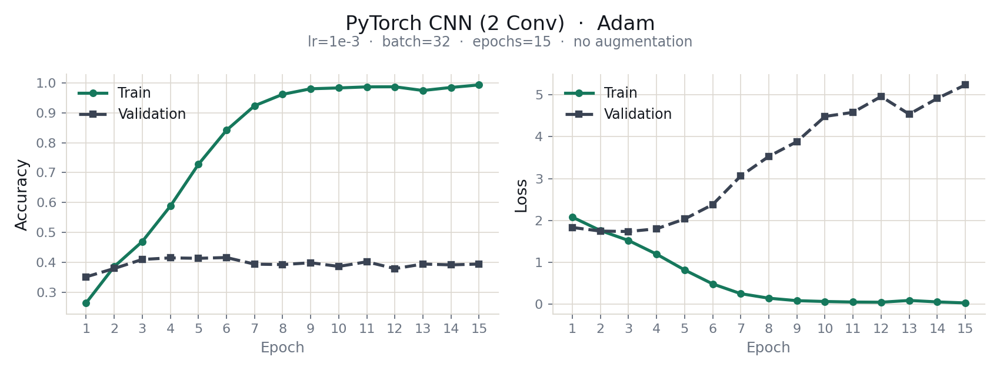
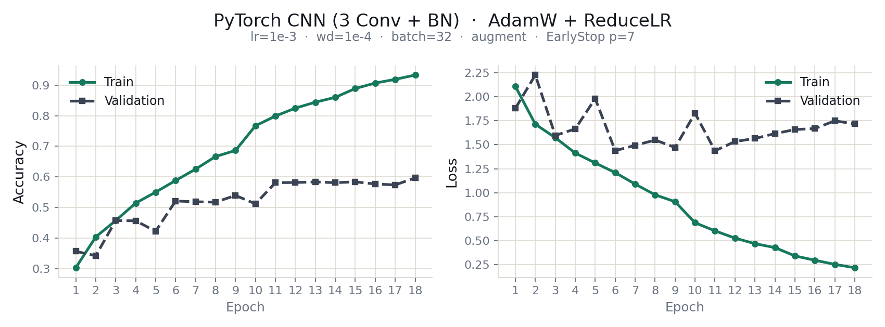
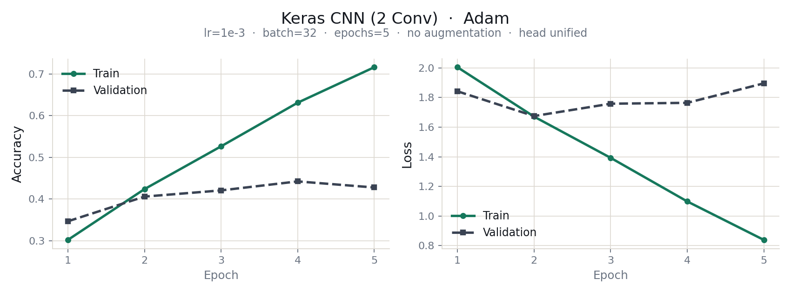
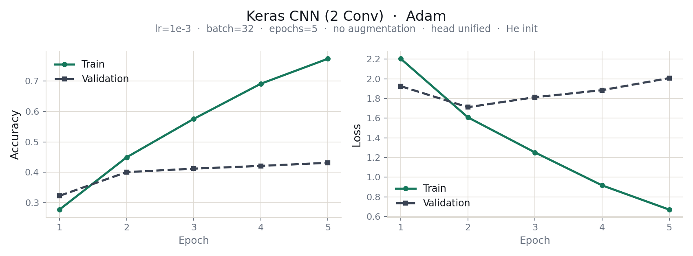
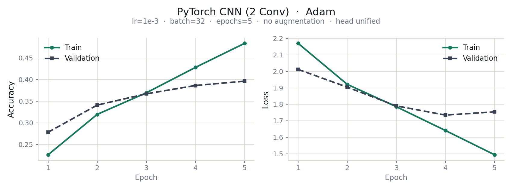
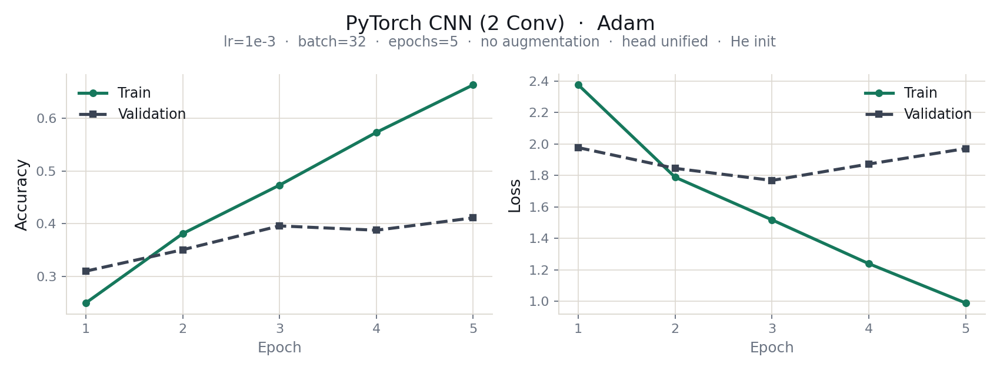

claude가 작성함

# Food-11 하이퍼파라미터 실험

음식 사진 분류 데이터셋 [Food-11](https://www.kaggle.com/datasets/trolukovich/food11-image-dataset)(11개 클래스, 16,643장)에서 작은 CNN을 학습시키며 **하이퍼파라미터를 한 번에 하나씩 바꿨을 때 성능이 얼마나 달라지는지** 재는 실험이다.

- **같은 실험을 Keras와 PyTorch에서 한다.** 두 프레임워크를 비교하는 게 목적은 아니다. 효과는 프레임워크 안에서 재고, 양쪽이 같은 방향이면 근거가 강해진다고 본다.
- **시드를 바꿔 반복한다.** 우연으로 생기는 흔들림 폭부터 재고, 그보다 큰 차이만 효과로 읽는다.
- 학습은 모두 Google Colab(GPU T4)에서 했다. 데이터셋은 이 저장소에 들어 있지 않다.

---

## 지금까지의 결론

2026-11-02 기준이며 아직 진행 중인 실험이다.

1. **He 초기화는 학습 속도만 바꿨고 일반화는 바꾸지 못했다.** 시드 3개로 확인했을 때 val·test 정확도의 변화는 시드 사이의 흔들림 안에 있었다.
2. **최적 학습률은 옵티마이저마다 10배씩 달랐다.** Adam 1e-4, SGD+momentum 1e-3, SGD 1e-2였고 두 프레임워크가 똑같이 나왔다 (시드 0으로 한 번씩 훑어본 결과).
3. **정확도의 병목은 학습 속도가 아니라 과적합으로 보인다 (가설).** 잘 학습되는 설정의 val 정확도는 38~43%에 모이는데 train 정확도는 그보다 훨씬 높다 (예: Keras · Adam 1e-3은 train 77.6%, val 41.5%). Dropout 비율과 데이터 증강 같은 정규화가 다음 후보다.
4. **학습률 단계의 3시드 확인은 결과를 기다리는 중이다.** 노트북은 준비되어 있다.

---

## 진행 상황

실행 1번은 Keras 약 2.5분, PyTorch 약 4.5분이다 (T4 기준). 노트북은 실행 출력이 비어 있고, 결과는 아래 "결과"에 요약했다.

| 단계 | 노트북 | 내용 | 상태 | Colab |
|---|---|---|---|---|
| 0단계 | [`basic_unified.ipynb`](colab_v2/basic_unified.ipynb) | 기준선 — 분류 헤드만 통일한 2 Conv. 두 프레임워크 모두 파라미터 653,003개 | 완료 | [](https://colab.research.google.com/github/JungUH-0/hyperparameter-study/blob/main/colab_v2/basic_unified.ipynb) |
| 1단계 | [`step1_he_init.ipynb`](colab_v2/step1_he_init.ipynb) | He 초기화 하나만 변경 | 완료 | [](https://colab.research.google.com/github/JungUH-0/hyperparameter-study/blob/main/colab_v2/step1_he_init.ipynb) |
| 시드 반복 | [`seed_repeat.ipynb`](colab_v2/seed_repeat.ipynb) | 0·1단계 × 두 프레임워크 × 시드 0·1·2 (12번, 약 45분) | 완료 | [](https://colab.research.google.com/github/JungUH-0/hyperparameter-study/blob/main/colab_v2/seed_repeat.ipynb) |
| 2단계 | [`step2_learning_rate.ipynb`](colab_v2/step2_learning_rate.ipynb) | 옵티마이저 3개 × 학습률 4개(1e-4~1e-1), 시드 0, 두 프레임워크 (24번, 약 84분) | 완료 | [](https://colab.research.google.com/github/JungUH-0/hyperparameter-study/blob/main/colab_v2/step2_learning_rate.ipynb) |
| 2단계 마무리 | [`step2_lr_seeds.ipynb`](colab_v2/step2_lr_seeds.ipynb) | 후보 4개 × 시드 1·2 (시드 0은 위 결과를 재사용, 16번, 약 56분). 학습률 결론과 옵티마이저 비교 | 노트북 준비됨, 결과 대기 | [](https://colab.research.google.com/github/JungUH-0/hyperparameter-study/blob/main/colab_v2/step2_lr_seeds.ipynb) |
| 다음 | — | 옵티마이저 비교, 정규화(Dropout 비율·데이터 증강), (선택) 구조·배치 크기 | 예정 | — |

---

## 방법

- **기준선**: 2 Conv(32·64) + Dropout 0.5 + Dense(11). 입력 128×128, batch 32, 5 epoch, 증강 없음, Adam lr 1e-3. 0단계에서 두 프레임워크의 파라미터 수가 같은지(653,003개) 먼저 확인한다. 1단계에서 He 초기화를 적용해 보고, 이후 튜닝은 He를 기준선으로 쓴다.
- **한 번에 하나만 바꾼다.** 기준선에서 하나만 바꿔 기준선과 비교하고, 앞 단계 결과 위에 쌓지 않는다.
- **시드 0·1·2로 반복한다.** 같은 시드끼리 뺀 값이 시드 전부에서 같은 방향이고 평균 차이가 시드 범위보다 클 때만 "뚜렷한 효과"로 읽는다.
- **옵티마이저마다 학습률을 따로 찾는다.** 적정 학습률은 옵티마이저마다 자릿수가 다르다.
- **고르는 건 val이고 test는 보고용이다.**

---

## 결과

### v1 — 30개 조합, 36회 학습 (`colab_final/`)

기본 CNN에서 출발해 증강, 구조, 옵티마이저를 단계적으로 바꿨다. 아래는 test 정확도다.

| 단계 (앞 단계 위에 쌓음) | Keras | PyTorch |
|---|---|---|
| 기본 CNN (2 Conv, 5 epoch) | 43.6% | 44.1% |
| + epoch 15 | 45.4% | 44.4% (Adam) |
| + 증강 + EarlyStopping | 50.9% | 50.9% |
| + 3 Conv + BatchNorm + He | 56.1% | 54.5% |
| + AdamW + ReduceLROnPlateau | 52.1% (재실행 56.7%) | 59.2% (재실행 **61.9%**) |

한 단계에서 2~3개를 같이 바꿨고 같은 조건을 다시 돌리면 test가 최대 4.6%p 달라졌다. 그래서 위 표의 증감이 무엇 때문인지는 가릴 수 없다. 61.9%는 v1 전체 측정 중 최댓값이고 같은 조건 2회 평균은 60.6%다.

<table>
  <tr>
    <td align="center"><br>PyTorch · 2 Conv · Adam · 15 epoch<br>train 정확도는 0.99까지 오르는데 val 정확도는 0.40 근처에서 멈추고 val loss는 5까지 치솟는다</td>
    <td align="center"><br>PyTorch · 3 Conv + BN · AdamW + ReduceLR · 증강<br>val 정확도는 약 0.6까지 오르지만 train(0.93)과의 격차는 여전히 크다</td>
  </tr>
</table>

v1의 다른 곡선은 [`curves/`](curves/)에 있다 (`orig/`는 라벨을 고치기 전 원본).

### v1의 문제점과 v2의 대응

v1은 "이 하이퍼파라미터를 바꿨더니 이런 효과가 났다"고 말할 수 없는 설계였다. 정확도가 낮아서가 아니라, 숫자가 달라졌을 때 그 원인을 하나로 가려낼 수 없었기 때문이다. 부분적으로 고쳐 다시 돌리는 것으로는 해결되지 않아서(문제가 개별 실행이 아니라 조건을 쌓아 온 방식에 있다), 가장 기초 모델에서 출발해 한 번에 하나씩 다시 쌓는다. v1 코드는 기록된 결과와 맞물려 있어 그대로 두었다.

| # | 문제 | 확인된 사실 | v2에서 막는 방법 |
|---|---|---|---|
| 1 | 우연을 통제하지 않았다 | 시드 미고정, 대부분 1회 실행. 같은 설정을 다시 돌리면 test가 최대 **4.6%p** 달라졌다 | 시드 고정 + 시드 0·1·2 반복으로 흔들림 폭부터 잰다 |
| 2 | 한 번에 여러 개를 바꿨다 | "3 Conv + BatchNorm + He", "AdamW + ReduceLR + patience"처럼 한 단계에서 3개씩 같이 바꿈 → 어느 것의 효과인지 분리 불가 | 기준선에서 한 번에 하나만 바꾼다 |
| 3 | 두 프레임워크가 같은 모델이 아니었다 | 파라미터 653,003 대 7,393,739 (**11.3배**) — PyTorch에만 은닉층, Keras에만 Dropout | 같은 구조로 맞추고 파라미터 수부터 확인한다 ([`basic_unified.py`](colab_v2/basic_unified.py): 둘 다 653,003) |
| 4 | 학습률을 통제 변수로 썼다 | 전 구간 1e-3 고정 — Adam에겐 기본값이지만 SGD에겐 평소의 1/10 | 옵티마이저마다 맞는 학습률을 직접 찾는다 (2단계) |
| 5 | 최고 기록에 선택 편향 | 61.9%는 전체 측정 중 최댓값이고 같은 조건 2회 평균은 60.6% | 고르는 건 val, test는 보고용 |
| 6 | 두 프레임워크 사이 설정·기본값이 어긋났다 | 증강 회전 ±36° 대 ±10°(단위 차이), EarlyStopping patience 3 대 5, 기본 초기화 차이(PyTorch 기본은 He보다 약 2.45배 작다) | 직접 정하는 값은 양쪽을 같게 한다. 기본값 차이는 목록으로 관리하다가 두 프레임워크 결과가 다를 때 하나씩 맞춘다 |

### v2 — 기준선과 He 초기화 (0·1단계, 시드 반복)

5에폭 끝 값, 시드 3개의 평균 [최소~최대], 단위는 %다. val loss 최저는 에폭별 val loss의 최솟값(평균)이다.

| 조건 | train acc | val acc | val loss 최저 | test acc |
|---|---|---|---|---|
| Keras · 기본 초기화 | 72.2 [68.7~76.4] | 40.1 [37.7~43.0] | 1.73 | 43.7 [41.8~46.9] |
| Keras · He | 75.5 [71.6~78.0] | 39.8 [38.5~41.7] | 1.75 | 43.5 [42.1~45.5] |
| PyTorch · 기본 초기화 | 48.7 [41.7~54.3] | 39.3 [36.7~41.9] | 1.75 | 40.9 [37.8~42.9] |
| PyTorch · He | 66.7 [65.6~68.7] | 40.9 [40.5~41.3] | 1.78 | 43.7 [43.1~44.3] |

- **He는 학습 속도를 바꿨지 일반화를 바꾸지는 못했다.** val loss 최저는 네 조건 모두 1.73~1.78로 같고, 거기에 닿는 시점만 달랐다 (PyTorch 평균 4.7에폭 → 2.3에폭, Keras 2.0 → 2.3).
- PyTorch에서는 train 정확도가 모든 시드에서 올랐다 (평균 +18.0%p). Keras에서는 방향이 시드마다 섞였다.
- He에서는 두 프레임워크의 test 정확도가 43.5~43.7%로 만난다. 기본 초기화에서는 같은 시드끼리 Keras가 평균 2.8%p 높았다.
- 모든 조건에서 2~3에폭 뒤부터 val loss가 오른다. 5에폭 안에 과적합이 시작된다.

<table>
  <tr>
    <td align="center"><br>Keras · 기본 초기화</td>
    <td align="center"><br>Keras · He 초기화</td>
  </tr>
  <tr>
    <td align="center"><br>PyTorch · 기본 초기화</td>
    <td align="center"><br>PyTorch · He 초기화</td>
  </tr>
</table>

위 곡선은 시드 0 한 번의 결과다. He를 쓰면 train이 빨라지고, val은 두 경우 모두 2~4에폭 뒤부터 오르기 시작한다.

### v2 — 학습률 (2단계, 시드 0)

옵티마이저 3개(Adam, SGD + momentum 0.9, SGD) × 학습률 4개(1e-4, 1e-3, 1e-2, 1e-1) × 두 프레임워크, 시드 0 한 번씩, 5에폭이다.

| 옵티마이저 | 최적 학습률 (val 기준) | val acc (Keras / PyTorch) | 학습이 무너지는 학습률 |
|---|---|---|---|
| Adam | 1e-4 (격자 끝) | 43.1% / 42.3% | 1e-2 이상 |
| SGD + momentum | 1e-3 | 43.2% / 41.2% | 1e-1 |
| SGD | 1e-2 | 33.7% / 35.1% | 1e-1 |

- **최적 학습률은 옵티마이저마다 10배씩 달랐고 두 프레임워크가 똑같았다.** v1처럼 전부 1e-3으로 두면 맞지 않는다.
- **무너진 실행은 NaN이 아니라 입력과 무관하게 한 클래스만 내놓는 상태다** (val 정확도 14.6%, val loss 2.30에 붙는다).
- **최적 근처는 평평하다.** Adam 1e-4와 1e-3의 val 정확도 차이(1.6~2.2%p)는 같은 설정을 다시 돌렸을 때의 흔들림과 같은 크기라서, 시드 1개로는 우열을 가릴 수 없다. 이를 3시드로 확인하는 노트북(`step2_lr_seeds.ipynb`)이 준비되어 있고, 결과를 보기 전에 판정 규칙을 노트북 안에 적어 두었다.
- 최저 에폭이 5(5에폭이 끝날 때도 val loss가 내려가는 중)인 설정이 많아서, 위 최적 학습률은 "5에폭 기준"이다.

---

## 저장소 구조

```
.
├─ README.md
├─ requirements.txt              torch, torchvision, keras (최소 목록)
├─ batchnorm_earlystopping.txt   v1에서 만난 BatchNorm ↔ EarlyStopping 충돌 정리
├─ colab_final/                  v1 실험 코드 (결과와 맞물려 있어 수정하지 않았다)
│   ├─ keras1.py ~ keras4.py, torch1.py ~ torch3.py
│   └─ hyperparameters.txt       스크립트별 설정 비교
├─ colab_v2/                     v2 실험
│   ├─ basic_unified.py          0단계 기준선 (원본), basic_unified.ipynb는 Colab용 사본
│   ├─ step1_he_init.ipynb       1단계
│   ├─ seed_repeat.ipynb         시드 반복
│   ├─ step2_learning_rate.ipynb 2단계
│   ├─ step2_lr_seeds.ipynb      2단계 마무리 (3시드 확인)
│   ├─ curve_v2_*.png            0·1단계 학습 곡선
│   ├─ README.md                 v2 설계 문서 (처음 계획한 Phase 1~4)
│   └─ common.py, phases.py      설계 단계에서 만든 하네스 (아직 실행해 본 적 없다)
└─ curves/                       v1 학습 곡선 (orig/ = 라벨을 고치기 전 원본)
```

[`colab_v2/README.md`](colab_v2/README.md)는 처음 계획한 설계 문서라서 실제 진행(위의 단계식 노트북)과 다르다.

---

## 재현 방법 (Colab)

1. Kaggle에서 Food-11을 받아 Google Drive의 `MyDrive/food11`에 올린다. 안에 `training`, `validation`, `evaluation` 폴더가 있어야 한다.
2. 위 표의 Colab 배지로 노트북을 열고 런타임을 GPU로 바꾼다.
3. 위에서부터 셀을 차례로 실행한다. 모든 노트북의 데이터 셀이 Drive를 마운트하고 데이터를 `/content/food11`로 복사한다. Drive에서 직접 읽으면 학습이 수십 배 느려지므로 반드시 복사해서 쓴다. 런타임이 끊기면 다시 복사해야 한다.
4. `seed_repeat`과 `step2_*` 노트북은 실행이 하나 끝날 때마다 Drive의 CSV(`food11_v2_seeds.csv`, `food11_v2_lr.csv`)에 한 줄씩 저장한다. 런타임이 끊겨도 앞선 결과는 남고, 다시 돌리면 끝난 실행은 건너뛰고 이어서 한다.
5. 이 노트북들의 마지막 셀이 결과표와 그래프를 만든다.

v1은 `colab_final/`의 스크립트를 셀에 붙여넣어 하나씩 실행한다 (`DATA_DIR = "/content/food11"`). 무료 Colab은 GPU 할당량이 떨어지면 몇 시간 기다려야 한다.

---

## 한계

- **5에폭 고정이다.** 학습률처럼 에폭 수와 얽힌 결과는 더 길게 돌리면 달라질 수 있다.
- **시드 3개로 가려낼 수 있는 효과는 대략 3~4%p 이상이다.** 같은 설정을 같은 시드로 다시 돌려도 GPU 비결정성 때문에 정확도가 최대 약 1.5%p 흔들린다.
- **하나씩 바꾸는 순차 튜닝이라 설정끼리의 상호작용은 못 본다.** 예를 들어 정규화를 넣으면 최적 학습률이 달라질 수 있다.
- **프레임워크 사이에 남은 차이가 있다.** 이미지 축소 방식과 데이터를 섞는 방식이 다르고, 통일은 He 초기화까지만 했다. 목적이 두 프레임워크 비교가 아니라서, 튜닝 효과의 방향이 두 프레임워크에서 다르게 나올 때만 원인 후보로 본다.

---

## 환경과 데이터

- 실험은 Google Colab(GPU T4)에서 했다. [`requirements.txt`](requirements.txt)는 `torch`, `torchvision`, `keras`만 적은 최소 목록이다. Keras 3은 백엔드(TensorFlow 등)를 따로 설치해야 하고, Colab에는 이미 들어 있다.
- 데이터셋은 Kaggle의 [Food-11](https://www.kaggle.com/datasets/trolukovich/food11-image-dataset)(training 9,866장 · validation 3,430장 · evaluation 3,347장)이고, 이 저장소에는 포함되어 있지 않다.
