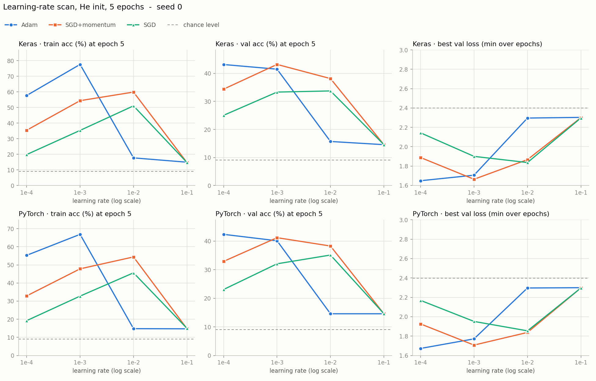
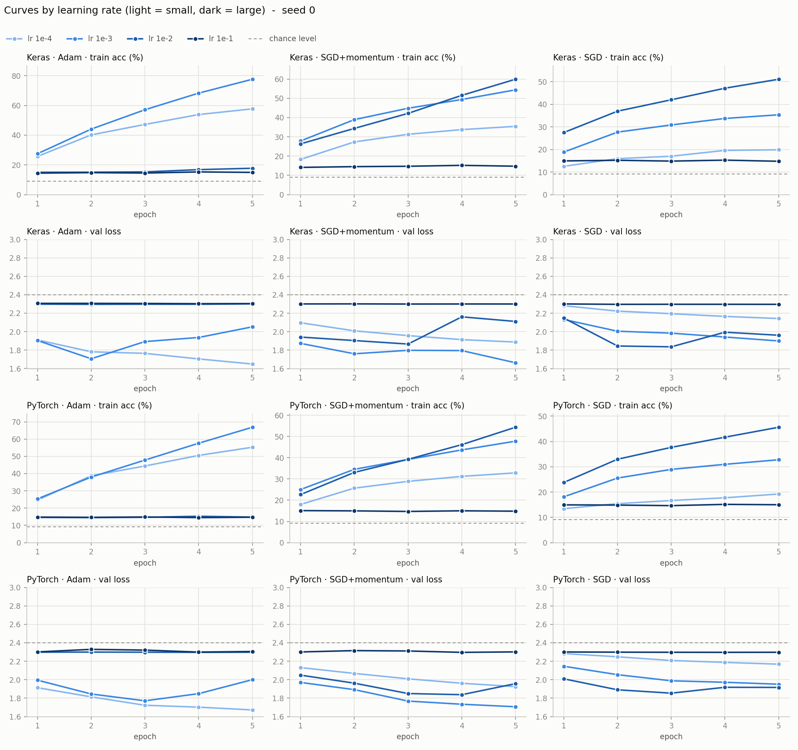

# 2단계 학습률 — 시드 0 훑어보기 (24번)

옵티마이저마다 학습률을 어느 자릿수로 잡아야 하는지 크게 훑어본 결과다. 시드 0 한 번씩이라서 가까운 후보끼리의 우열은 읽지 않는다.

- 노트북: [`colab_v2/step2_learning_rate.ipynb`](../colab_v2/step2_learning_rate.ipynb)
- 실행일: 2026-10-29
- 조건: He 초기화, 2 Conv(32·64) + Dropout 0.5 + Dense(11), batch 32, 5 epoch, 증강 없음, 학습률 고정(스케줄러 없음), 시드 0
- 변수: 옵티마이저 3개(Adam · SGD + momentum 0.9 · SGD) × 학습률 4개(1e-4 · 1e-3 · 1e-2 · 1e-1) × 프레임워크 2개 = 24번

---

## 결과표

5에폭이 끝났을 때의 값이고 단위는 %다. 한 행에 Keras와 PyTorch가 같이 들어 있어서 12행이 24번이다.

| 옵티마이저 · 학습률 | Keras train / val / test | Keras val loss 최저 (에폭) | PyTorch train / val / test | PyTorch val loss 최저 (에폭) |
|---|---|---|---|---|
| Adam · 1e-4 | 57.7 / **43.1** / 44.3 | 1.65 (5) | 55.3 / **42.3** / 44.3 | 1.67 (5) |
| Adam · 1e-3 | 77.6 / 41.5 / 45.3 | 1.71 (2) | 66.8 / 40.1 / 42.2 | 1.77 (3) |
| Adam · 1e-2 | 17.7 / 15.7 / 16.4 | 2.30 (2) | 14.8 / 14.6 / 14.9 | 2.30 (4) |
| Adam · 1e-1 | 15.0 / 14.6 / 14.9 | 2.30 (4) | 14.7 / 14.6 / 14.9 | 2.30 (4) |
| SGD + momentum · 1e-4 | 35.4 / 34.4 / 34.8 | 1.89 (5) | 32.9 / 32.9 / 34.4 | 1.93 (5) |
| SGD + momentum · 1e-3 | 54.4 / **43.2** / 44.7 | 1.66 (5) | 47.8 / **41.2** / 42.0 | 1.71 (5) |
| SGD + momentum · 1e-2 | 59.9 / 38.1 / 40.6 | 1.87 (3) | 54.4 / 38.3 / 40.1 | 1.84 (4) |
| SGD + momentum · 1e-1 | 14.8 / 14.6 / 14.9 | 2.30 (3) | 14.8 / 14.6 / 14.9 | 2.30 (4) |
| SGD · 1e-4 | 19.9 / 25.0 / 25.5 | 2.14 (5) | 19.2 / 23.1 / 23.3 | 2.17 (5) |
| SGD · 1e-3 | 35.3 / 33.3 / 33.7 | 1.90 (5) | 32.8 / 32.0 / 33.5 | 1.95 (5) |
| SGD · 1e-2 | 51.1 / **33.7** / 35.5 | 1.84 (3) | 45.6 / **35.1** / 35.9 | 1.85 (3) |
| SGD · 1e-1 | 14.8 / 14.6 / 15.1 | 2.30 (2) | 15.0 / 14.6 / 14.9 | 2.30 (4) |

- **train / val / test**: 5에폭이 끝났을 때의 정확도(%)다.
- **val loss 최저 (에폭)**: 에폭별 val loss의 최솟값과 그 에폭이다. 5는 5에폭이 끝날 때도 계속 내려가는 중이었다는 뜻이다.
- **굵은 val**: 옵티마이저마다 val 기준으로 가장 좋은 학습률이다 (val loss 최저 기준과 같은 칸이다). 고르는 건 val이고 test는 보고용이다.

노트북의 원자료(에폭별 값)는 Drive의 `food11_v2_lr.csv`에 쌓인다. 이 저장소에는 없다.

---

## 그래프

두 그래프는 노트북 셀 4가 Colab에서 만든 것이다 (시드 0, 5에폭).

### 학습률에 따른 결과 (`lr_overview.png`)

위 줄이 Keras, 아래 줄이 PyTorch다. 왼쪽부터 5에폭 끝의 train 정확도, 5에폭 끝의 val 정확도, 에폭 중 최저 val loss이고, 선 하나가 옵티마이저 하나다. 가로축은 학습률(로그 눈금)이다.

- 점선은 균등하게 찍을 때의 값이다 (정확도 1/11 ≈ 9%, 손실 ln 11 ≈ 2.40). 무너진 점은 정확도 14.6%, 손실 2.30에 있어서 점선 위(정확도)와 아래(손실)에 놓인다. 한 클래스만 내놓는 상태라 균등하게 찍는 것보다 조금 낫기 때문이다.
- val 정확도가 가장 높은 학습률은 옵티마이저마다 다르고(Adam 1e-4, SGD + momentum 1e-3, SGD 1e-2) 두 프레임워크의 모양이 거의 같다.

### 에폭별 곡선 (`lr_curves.png`)

위에서부터 Keras train 정확도, Keras val loss, PyTorch train 정확도, PyTorch val loss다. 열은 옵티마이저(Adam, SGD + momentum, SGD)이고 선 하나가 학습률 하나다. 연한 색이 작은 학습률, 진한 색이 큰 학습률이다.

- Adam 1e-3(왼쪽 열)은 train이 가장 빨리 오르지만 val loss가 2~3에폭에서 바닥을 찍고 올라간다. Adam 1e-4는 5에폭 끝까지 계속 내려간다.
- 가장 진한 선(1e-1)은 처음부터 끝까지 평평하다. 첫 에폭부터 무너져 있다는 뜻이다. Adam은 1e-2도 거의 같다.

---

## 관찰

1. **최적 학습률은 옵티마이저마다 10배씩 달랐고 두 프레임워크가 똑같았다.** Adam 1e-4, SGD + momentum 1e-3, SGD 1e-2다. 전부 1e-3으로 고정하면 val 정확도를 Adam은 1.6%p(Keras)·2.2%p(PyTorch), SGD는 0.4%p·3.1%p 잃고 SGD + momentum은 잃지 않는다.
2. **SGD + momentum 1e-4와 SGD 1e-3은 곡선이 거의 같다.** Keras train 35.4 대 35.3, val loss 1.89 대 1.90, PyTorch train 32.9 대 32.8, val loss 1.93 대 1.95다. 작은 학습률에서는 "momentum 0.9는 학습률 10배와 같다"가 그대로 맞았다. 큰 쪽은 다르다. SGD + momentum 1e-2는 학습되는데 SGD 1e-1은 무너지고, SGD + momentum 1e-3은 SGD 1e-2보다 val 정확도가 6~10%p 높다.
3. **무너지는 구간은 Adam 1e-2 이상, SGD + momentum·SGD 1e-1이다.** NaN이 아니라 첫 에폭부터 입력과 무관하게 한 클래스만 내놓는 상태다 (val 14.6%, test 14.9%, val loss 2.30).
4. **가까운 후보끼리의 우열은 읽을 수 없다.** Adam 1e-4가 1e-3보다 val 정확도가 1.6%p(Keras)·2.2%p(PyTorch) 높지만, 같은 설정(Adam 1e-3, 시드 0)을 1단계에서 돌렸을 때와 이 단계에서 돌렸을 때의 Keras val이 43.1% 대 41.5%로 1.6%p 달랐다. 재실행 흔들림과 같은 크기다. val loss만 두 프레임워크에서 0.06, 0.10 낮아 약한 신호가 있다.
5. **Adam 1e-3은 2~3에폭에서 val loss가 바닥을 찍고 올라간다.** train 정확도는 계속 올라서 train 대 val이 Keras 77.6% 대 41.5%, PyTorch 66.8% 대 40.1%다. 학습률이 크면 과적합이 일찍 시작해 5에폭 끝의 val이 낮아진다. Adam 1e-4는 5에폭에도 과적합 전이다.
6. **val loss 바닥은 잘 배운 설정끼리 비슷하다.** Adam 1e-4·1e-3, SGD + momentum 1e-3의 val loss 최저는 1.65\~1.77로 1단계 기본값(1.73\~1.78)과 같은 자리다. 학습률은 그 바닥에 닿는 속도를 바꿨지 바닥을 크게 바꾸지는 못했다. 1e-2의 SGD 계열은 1.84\~1.87에서 올라가기 시작해 이 바닥에 닿지 못했다.
7. **SGD는 최적 학습률에서도 Adam·SGD + momentum보다 val 정확도가 6~10%p 낮다.** Keras 33.7 대 43.1·43.2, PyTorch 35.1 대 42.3·41.2다. 시드 1개라서 옵티마이저 비교 단계에서 다시 확인한다.
8. **두 프레임워크는 같은 방향이다.** 작동하는 설정에서 Keras가 train 정확도 +0.7~+10.8%p 높고 val은 2%p, test는 3%p 이내로 비슷하다. 방향이 갈린 항목은 없다. 경계인 Adam 1e-2에서만 Keras가 조금 새어 나왔다 (train 17.7 / val 15.7 / test 16.4%, PyTorch는 14.8 / 14.6 / 14.9).
9. **기준선 확인을 통과했다.** Adam · 1e-3 · 시드 0이 1단계(He) 시드 0과 재실행 차이 범위 안이었다 (Keras train +0.3%p / test −1.0%p, PyTorch +0.5%p / −0.7%p).

### 노트북에 적어 둔 예상 6개와 비교

1. Adam이 1e-3 근처에서 가장 좋다 — 절반만 맞았다. 1e-2 이상이 나쁘고 1e-4의 val loss 최저가 5에폭인 건 맞지만, val은 1e-4가 앞섰다 (train 정확도만 1e-3이 최고).
2. SGD + momentum의 최적은 1e-2 근처다 — 틀렸다 (1e-3). "Adam보다 한 자릿수 위"와 "1e-1은 불안정"은 맞았다.
3. SGD의 최적은 격자 맨 위(1e-1)다 — 틀렸다 (1e-2, 1e-1은 무너진다). 1e-3도 val 32~33%로 학습은 된다.
4. 최적 학습률은 SGD > SGD + momentum > Adam 순이고 간격은 10배 안팎이다 — 맞았다 (두 프레임워크 동일).
5. val loss 최저값은 잘 배우는 학습률끼리 비슷하다 — 대체로 맞았다.
6. 두 프레임워크에서 같은 방향이 나온다 — 맞았다.

---

## 한계

- 시드 1개라서 위 우열은 "학습률이 10배 달라질 때 나타나는 큰 변화"만 믿을 수 있다.
- 5에폭 고정이다. 최저 에폭이 5인 설정(Adam 1e-4, SGD + momentum 1e-3 등)은 더 길게 돌리면 결과가 달라질 수 있다. 위 최적 학습률은 "5에폭 기준"이다.
- Adam 1e-4는 격자 끝이다. 그보다 낮은 학습률은 보지 않았다.

## 다음

후보 4개(Adam 1e-4·1e-3, SGD + momentum 1e-3, SGD 1e-2)에 시드 1·2를 더해 3시드로 확인했다. 노트북은 [`colab_v2/step2_lr_seeds.ipynb`](../colab_v2/step2_lr_seeds.ipynb)이고, 결과는 [`step2_lr_seeds.md`](step2_lr_seeds.md)에 있다. 결론은 Adam 기준선 1e-3 유지, Adam ≈ SGD + momentum > SGD다.
