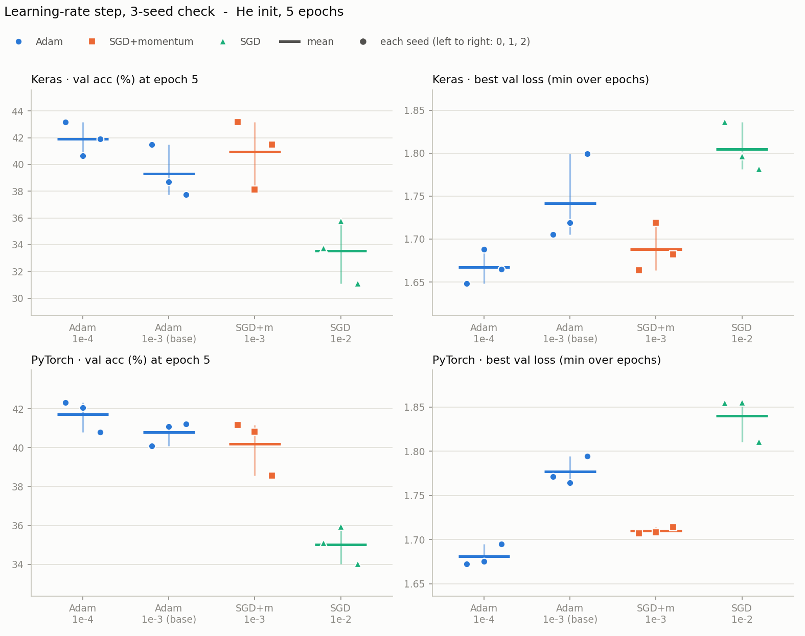

# 2단계 마무리 — 학습률 후보 4개 3시드 확인 (16번)

시드 0 훑어보기([결과](step2_learning_rate_seed0.md))에서 고른 후보 4개에 시드 1·2를 더해 3시드로 만든 결과다. Adam 기준선 학습률을 옮길지, 옵티마이저끼리 어떻게 다른지를 미리 정해 둔 규칙으로 판정했다.

- 노트북: [`colab_v2/step2_lr_seeds.ipynb`](../colab_v2/step2_lr_seeds.ipynb)
- 실행일: 2026-11-03
- 조건: 2단계와 같다. He 초기화, 2 Conv(32·64) + Dropout 0.5 + Dense(11), batch 32, 5 epoch, 증강 없음, 학습률 고정
- 후보 4개: Adam 1e-4, Adam 1e-3(현재 기준선), SGD + momentum 0.9 1e-3, SGD 1e-2
- 시드: 0, 1, 2. 시드 0은 2단계 결과를 그대로 썼고 시드 1·2만 새로 돌렸다 (프레임워크마다 8번, 합쳐 16번)

---

## 결과표

5에폭이 끝났을 때의 값이고 단위는 %다. 평균 [최소~최대]이고, val loss 최저는 에폭별 val loss의 최솟값이다. 최저 에폭은 그 값이 나온 에폭의 평균이다 (5는 끝날 때도 내려가는 중이었다는 뜻).

### Keras

| 후보 | train acc | val acc | val loss 최저 | 최저 에폭 | test acc |
|---|---|---|---|---|---|
| Adam · 1e-4 | 58.4 [57.7~59.1] | 41.9 [40.6~43.1] | 1.67 [1.65~1.69] | 4.7 [4.0~5.0] | 43.9 [43.2~44.3] |
| Adam · 1e-3 | 75.4 [71.1~77.6] | 39.3 [37.7~41.5] | 1.74 [1.71~1.80] | 2.3 [2.0~3.0] | 43.0 [41.9~45.3] |
| SGD + momentum · 1e-3 | 54.6 [54.4~55.0] | 40.9 [38.1~43.2] | 1.69 [1.66~1.72] | 4.3 [3.0~5.0] | 43.0 [41.1~44.7] |
| SGD · 1e-2 | 51.6 [51.1~52.7] | 33.5 [31.1~35.7] | 1.80 [1.78~1.84] | 3.3 [3.0~4.0] | 36.4 [33.9~39.9] |

### PyTorch

| 후보 | train acc | val acc | val loss 최저 | 최저 에폭 | test acc |
|---|---|---|---|---|---|
| Adam · 1e-4 | 54.8 [54.0~55.3] | 41.7 [40.8~42.3] | 1.68 [1.67~1.69] | 5.0 [5.0~5.0] | 43.4 [42.6~44.3] |
| Adam · 1e-3 | 67.2 [65.7~69.0] | 40.8 [40.1~41.2] | 1.78 [1.76~1.79] | 2.3 [2.0~3.0] | 43.4 [42.2~45.0] |
| SGD + momentum · 1e-3 | 49.3 [47.8~51.7] | 40.2 [38.6~41.2] | 1.71 [1.71~1.71] | 4.7 [4.0~5.0] | 41.2 [40.1~42.0] |
| SGD · 1e-2 | 46.5 [45.6~47.9] | 35.0 [34.0~35.9] | 1.84 [1.81~1.86] | 3.7 [3.0~4.0] | 36.3 [34.6~38.4] |

---

## 그래프

노트북 셀 4가 Colab에서 만든 그래프다. 위 줄이 Keras, 아래 줄이 PyTorch이고, 왼쪽 열은 5에폭 끝의 val 정확도(%), 오른쪽 열은 에폭 중 최저 val loss다. 점 하나가 시드 하나이고 같은 시드는 같은 가로 위치에 있다 (왼쪽부터 시드 0·1·2). 짧은 가로선이 3시드 평균이고 세로선이 최소~최대다.

- **오른쪽 아래(PyTorch val loss)**: Adam 1e-4의 세 점이 모두 Adam 1e-3(기준선)의 세 점보다 아래에 있고 폭도 좁다. 규칙 1을 통과한 칸이 이 한 칸이다. Keras의 같은 칸(오른쪽 위)도 1e-4의 세 점이 1e-3보다 아래에 있지만, 평균 차이(0.07)가 1e-3 점들이 흩어진 폭(0.09)보다 작아서 규칙은 "뚜렷함"으로 보지 않는다.
- **왼쪽 열(val 정확도)**: Adam 1e-4와 1e-3의 점이 서로 겹치거나 섞여 있고, SGD + momentum(주황)도 Adam과 겹친다. SGD(초록)만 두 프레임워크에서 val 정확도가 낮다 (val loss는 높다).

---

## 판정 규칙 (결과를 보기 전에 노트북에 적어 둔 것)

같은 시드끼리 뺀 값이 시드 전부에서 같은 방향이고, 평균 차이가 시드 범위(두 조건의 최대−최소 중 큰 쪽)보다 클 때만 "뚜렷함"으로 읽는다. 고르는 건 val이고 test는 보고용이다.

### 규칙 1 — Adam 기준선을 1e-3에서 1e-4로 옮길까

val acc와 val loss 최저 둘 다, 두 프레임워크 모두(4칸 전부)에서 1e-4가 뚜렷하게 앞설 때만 옮긴다. 하나라도 아니면 1e-3을 유지한다. 차이는 Adam 1e-4 − Adam 1e-3이고 val loss는 낮은 쪽이 낫다.

| 프레임워크 | 지표 | 차이 | 시드별 (0 · 1 · 2) | 시드 범위 | 판정 |
|---|---|---|---|---|---|
| Keras | val acc | +2.6%p | +1.7 · +2.0 · +4.2 | 3.8 | 구분 안 됨 — 방향은 같지만 평균 차이가 시드 범위 안 |
| Keras | val loss 최저 | −0.07 | −0.06 · −0.03 · −0.13 | 0.09 | 구분 안 됨 — 방향은 같지만 평균 차이가 시드 범위 안 |
| PyTorch | val acc | +0.9%p | +2.2 · +1.0 · −0.4 | 1.5 | 구분 안 됨 — 시드마다 방향이 다름 (1e-4 우세 2/3) |
| PyTorch | val loss 최저 | −0.10 | −0.10 · −0.09 · −0.10 | 0.03 | **Adam 1e-4 우세 (뚜렷함)** |

**결론: Adam 1e-3을 유지한다.** 1e-4가 앞선 칸은 4칸 중 1칸(PyTorch val loss 최저)뿐이고, 1e-3이 앞선 칸은 없고, 나머지 3칸은 구분되지 않았다.

### 규칙 2 — 옵티마이저 비교

옵티마이저마다 최적 후보끼리 val acc에 같은 기준을 적용했다. Adam은 두 후보 중 3시드 평균 val acc가 높은 쪽(두 프레임워크 모두 1e-4)이다. 차이는 앞쪽 − 뒤쪽이다.

| 프레임워크 | 비교 | 차이 | 시드별 (0 · 1 · 2) | 시드 범위 | 판정 |
|---|---|---|---|---|---|
| Keras | Adam 1e-4 − SGD+m 1e-3 | +1.0%p | −0.0 · +2.5 · +0.4 | 5.0 | 구분 안 됨 — 시드마다 방향이 다름 (Adam 1e-4 우세 2/3) |
| Keras | Adam 1e-4 − SGD 1e-2 | +8.4%p | +9.4 · +4.9 · +10.8 | 4.6 | **Adam 1e-4 우세 (뚜렷함)** |
| Keras | SGD+m 1e-3 − SGD 1e-2 | +7.4%p | +9.4 · +2.4 · +10.4 | 5.0 | **SGD+m 1e-3 우세 (뚜렷함)** |
| PyTorch | Adam 1e-4 − SGD+m 1e-3 | +1.5%p | +1.2 · +1.3 · +2.2 | 2.6 | 구분 안 됨 — 방향은 같지만 평균 차이가 시드 범위 안 |
| PyTorch | Adam 1e-4 − SGD 1e-2 | +6.7%p | +7.2 · +6.1 · +6.8 | 1.9 | **Adam 1e-4 우세 (뚜렷함)** |
| PyTorch | SGD+m 1e-3 − SGD 1e-2 | +5.2%p | +6.1 · +4.9 · +4.5 | 2.6 | **SGD+m 1e-3 우세 (뚜렷함)** |

**결론: Adam과 SGD + momentum은 구분되지 않고, SGD는 둘보다 val 정확도가 5~8%p 낮다.** 두 프레임워크가 같은 결과다.

---

## 관찰

1. **Adam 기준선은 1e-3을 유지한다.** 규칙을 통과하지 못했다. 다만 1e-4가 앞선 방향은 일관됐다. val 정확도는 Keras에서 시드 3개 모두 1e-4가 높았고(+2.6%p, 시드 범위 3.8 안), val loss는 두 프레임워크 모두 시드 3개 전부 1e-4가 낮았다.
2. **1e-4는 val loss 바닥이 더 낮다.** Keras −0.07(시드 범위 0.09, 근소 미달), PyTorch −0.10(시드 범위 0.03, 뚜렷함)이다. 1e-3은 과적합이 일찍 시작해서 바닥이 얕다는 설명과 맞는다. 평균 최저 에폭이 1e-4는 Keras 4.7, PyTorch 5.0(끝날 때도 내려가는 중)이고 1e-3은 둘 다 2.3이다.
3. **그런데 정확도에서는 구분되지 않는다.** val 정확도 차이는 시드 범위 안이었고, test 정확도는 PyTorch에서 43.4% 대 43.4%로 같고 Keras에서 43.9% 대 43.0%(시드 범위 안)다. 1e-3으로 두어도 일반화 성능을 잃지 않는다. 학습률로 바뀌는 건 속도와 val loss 바닥이었다.
4. **과적합은 1e-3에서 더 크다.** train 대 val 격차가 Adam 1e-3은 Keras 36%p(75.4 대 39.3), PyTorch 26%p(67.2 대 40.8)이고, Adam 1e-4는 Keras 17%p, PyTorch 13%p다. SGD + momentum 1e-3은 Keras 14%p, PyTorch 9%p다.
5. **Adam과 SGD + momentum은 구분되지 않는다.** Keras에서는 시드마다 방향이 갈렸고(+1.0%p), PyTorch에서는 Adam이 3시드 모두 높았지만 평균 차이(+1.5%p)가 시드 범위(2.6) 안이었다.
6. **SGD는 최적 학습률에서도 뚜렷하게 낮다.** Adam보다 6.7~8.4%p, SGD + momentum보다 5.2~7.4%p 낮다. 두 프레임워크가 같다.
7. **시드 사이의 흔들림이 크다.** val 정확도의 시드 범위가 Keras는 2.5~5.1%p, PyTorch는 1.1~2.6%p다. Keras 쪽이 더 크게 흔들렸다. 3시드로 가려낼 수 있는 차이는 대략 4~5%p 이상(Keras 기준)이다.
8. **시드 0 한 번의 값은 높게 나오는 경향이 있었다.** Keras에서 시드 0의 val 정확도가 3시드 평균보다 0.2~2.3%p 높았다(Adam 1e-4 43.1 대 41.9, SGD + momentum 43.2 대 40.9). 시드 0 훑어보기 표의 최고 val 43% 안팎은 3시드 평균으로는 42% 안팎이다.

### 노트북에 적어 둔 예상 5개와 비교

1. Adam 1e-4 대 1e-3은 규칙 1을 통과하지 못할 것이다 — 맞았다 (4칸 중 1칸).
2. val loss 최저는 1e-4 쪽이 낮게 나올 것이다 — 맞았다. 두 프레임워크 모두 시드 3개 전부 같은 방향이고 PyTorch에서는 뚜렷하다. 다만 규칙 1은 val 정확도까지 요구해서 이것만으로 기준선을 옮기지는 않는다.
3. Adam과 SGD + momentum은 구분되지 않고 SGD는 둘보다 낮을 것이다 — 맞았다 (두 프레임워크).
4. val loss 최저 에폭은 Adam 1e-4가 5(끝날 때도 내려가는 중), 1e-3이 2~3에폭일 것이다 — 맞았다 (4.7·5.0 대 2.3·2.3).
5. 두 프레임워크에서 같은 방향이 나올 것이다 — 맞았다. 규칙 1의 4칸 중 방향이 갈린 건 PyTorch val acc 한 칸(차이 +0.9%p)뿐이고, 옵티마이저 비교의 결과는 두 프레임워크가 같다.

---

## 한계

- 시드 3개다. 규칙은 3~4%p 이상의 차이만 잡는다. 1e-4와 1e-3의 정확도 차이는 이보다 작아서 "차이가 없다"가 아니라 "이 시드 수로는 가릴 수 없다"이다.
- 5에폭 고정이다. 1e-4와 SGD + momentum 1e-3은 최저 에폭이 5에 가까워서 더 길게 돌리면 결과가 달라질 수 있다.
- Adam 1e-4는 여전히 격자 끝이다. 그보다 낮은 학습률(3e-5 등)은 보지 않았다.
- SGD + momentum과 SGD는 후보가 하나씩이라 이웃 학습률과 3시드로 비교하지 않았다 (2단계 시드 0의 자릿수 결과를 따랐다).
- 시드 0은 2단계 실행 결과를 재사용했다. 같은 코드지만 다른 실행이라 GPU 비결정성의 영향이 있다.

## 다음

학습률 단계와 옵티마이저 비교가 이 결과로 끝났다. 기준선은 He 초기화 + Adam 1e-3 그대로다. 다음은 정규화(Dropout 비율·데이터 증강)다. 정규화를 넣으면 5에폭이 짧을 수 있어서, 들어가기 전에 에폭 수를 어떻게 할지 정한다.
