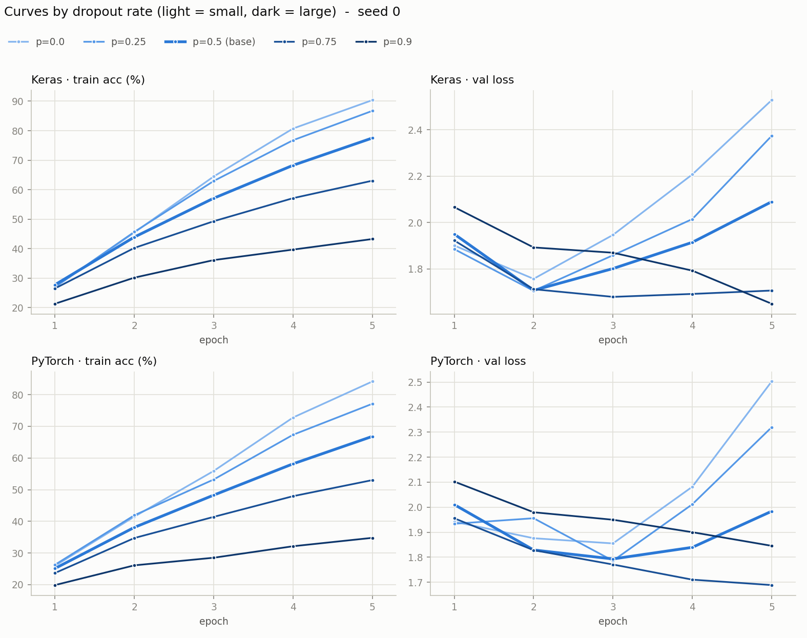
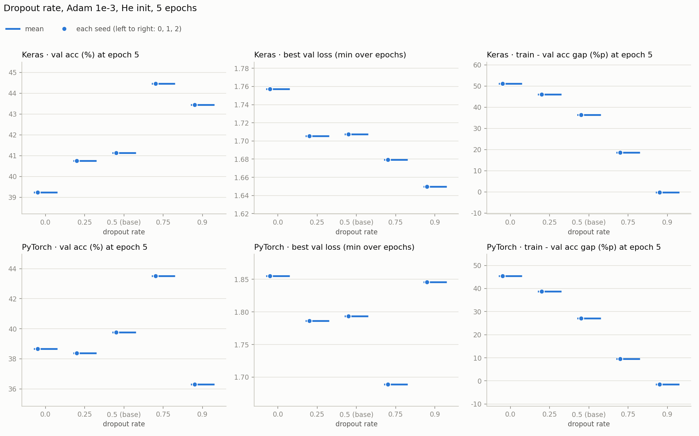
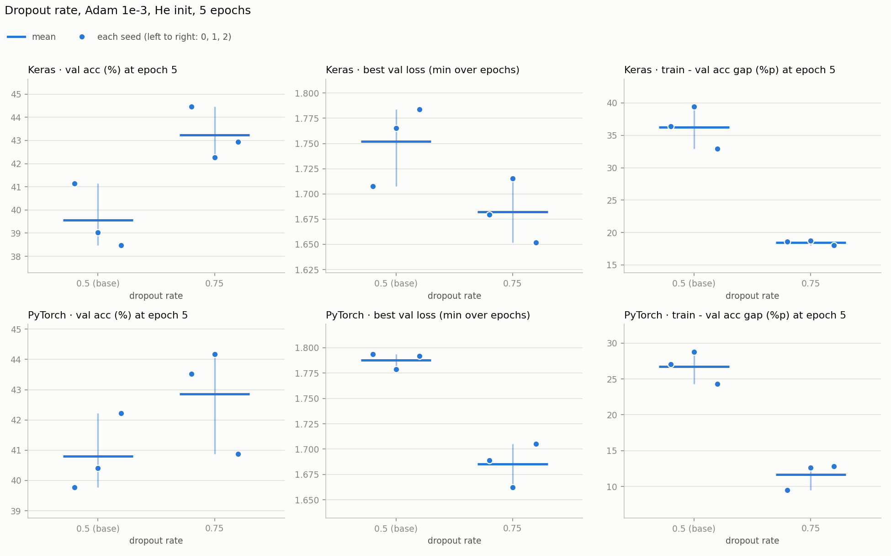
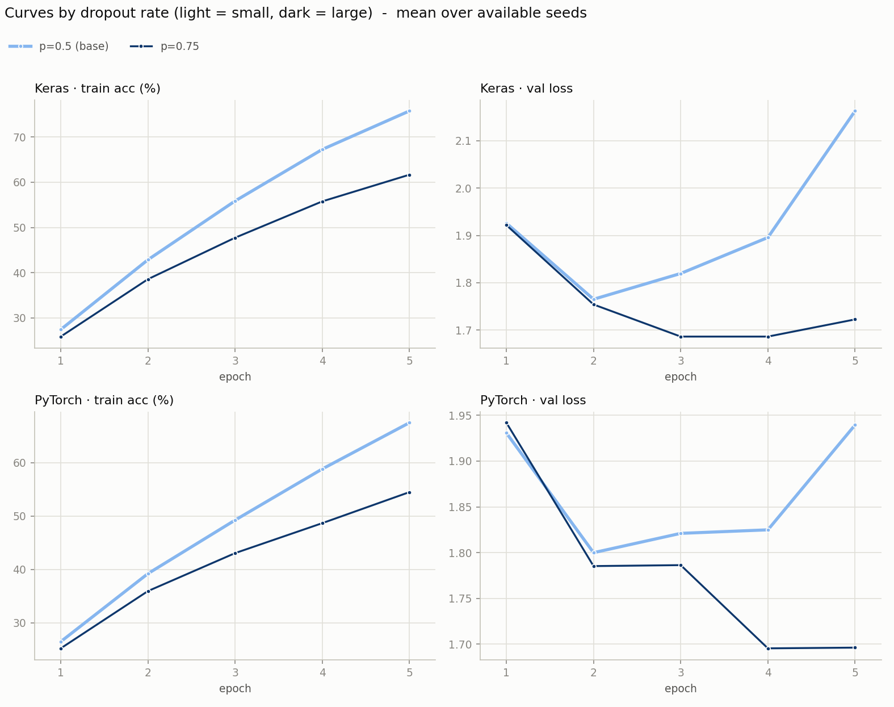

# 3단계 — Dropout 비율 (시드 0 훑어보기 10번 + 3시드 확인 8번)

2단계까지 보면 정확도의 병목은 학습 속도가 아니라 과적합이었다 (train 정확도는 70%대까지 오르는데 val은 40% 안팎). 정규화 중 첫 번째로 Dropout 비율을 하나만 바꿔 봤다. 시드 0으로 비율 5개를 훑어보고, 가장 앞선 값(0.75)을 시드 3개로 확인했다.

- 노트북: [`colab_v2/step3_dropout.ipynb`](../colab_v2/step3_dropout.ipynb)
- 실행일: 2026-11-06 (훑어보기와 3시드 확인 모두)
- 조건: He 초기화, 2 Conv(32·64) + Dropout + Dense(11), Adam 1e-3, batch 32, **5 epoch 고정**, 증강 없음, 학습률 고정. 바꾼 것은 Dropout 비율 하나다
- 훑어보기: 비율 0.0(끔) · 0.25 · 0.5(현재 기준선) · 0.75 · 0.9, 시드 0, 두 프레임워크 (10번, 약 35분)
- 3시드 확인: 0.5와 0.75에 시드 1·2를 더했다. 시드 0은 훑어보기 결과를 그대로 썼다 (프레임워크마다 4번, 합쳐 8번)

---

## 결과표 — 시드 0 훑어보기

5에폭이 끝났을 때의 값이고 단위는 %다. val loss 최저와 최저 에폭은 5에폭 중 val loss가 가장 낮았던 값과 그 에폭이다. 비고의 `최저 에폭=마지막`은 5에폭이 끝날 때도 val loss가 내려가는 중이었다는 뜻이다.

### Keras

| Dropout | train acc | val acc | train − val %p | val loss 최저 | 최저 에폭 | test acc | 비고 |
|---|---|---|---|---|---|---|---|
| 0.0 | 90.4 | 39.2 | 51.1 | 1.76 | 2 | 44.4 | |
| 0.25 | 86.7 | 40.8 | 46.0 | 1.71 | 2 | 44.3 | |
| 0.5 | 77.5 | 41.1 | 36.4 | 1.71 | 2 | 45.9 | 기준선 |
| 0.75 | 63.0 | 44.5 | 18.6 | 1.68 | 3 | 47.8 | |
| 0.9 | 43.3 | 43.4 | −0.2 | 1.65 | 5 | 44.0 | 최저 에폭=마지막 |

### PyTorch

| Dropout | train acc | val acc | train − val %p | val loss 최저 | 최저 에폭 | test acc | 비고 |
|---|---|---|---|---|---|---|---|
| 0.0 | 84.2 | 38.7 | 45.5 | 1.86 | 3 | 42.0 | |
| 0.25 | 77.1 | 38.4 | 38.8 | 1.79 | 3 | 42.2 | |
| 0.5 | 66.8 | 39.8 | 27.1 | 1.79 | 3 | 43.1 | 기준선 |
| 0.75 | 53.0 | 43.5 | 9.5 | 1.69 | 5 | 46.1 | 최저 에폭=마지막 |
| 0.9 | 34.8 | 36.3 | −1.5 | 1.85 | 5 | 38.6 | 최저 에폭=마지막 |

### 기준선(0.5)과의 차이

같은 시드 0끼리 뺀 값이다 (비율 − 0.5). val loss는 낮은 쪽이 낫다. 시드가 하나라서 판정하지 않고 "4칸이 전부 기준선보다 유리한 쪽인 값만 3시드로 넘긴다"는 절차로 후보를 골랐다.

| Dropout | Keras val acc | Keras val loss | PyTorch val acc | PyTorch val loss | 4칸 모두 유리? |
|---|---|---|---|---|---|
| 0.0 | −1.9%p | +0.050 | −1.1%p | +0.062 | 아니오 |
| 0.25 | −0.4%p | −0.002 | −1.4%p | −0.007 | 아니오 (val acc가 낮다) |
| 0.75 | +3.3%p | −0.028 | +3.8%p | −0.104 | **예** |
| 0.9 | +2.3%p | −0.058 | −3.5%p | +0.052 | 아니오 (PyTorch가 반대) |

0.75만 4칸이 전부 유리해서 3시드로 넘겼다.

### 그래프 (시드 0)

비율 5개의 곡선이다 (밝은 색이 작은 비율, 어두운 색이 큰 비율). 왼쪽 열이 train 정확도, 오른쪽 열이 val loss이고 위가 Keras, 아래가 PyTorch다. 비율이 낮은 쪽(0.0, 0.25)은 val loss가 2~3에폭에서 바닥을 찍고 가파르게 오른다 (0.0은 5에폭에 2.5). 0.75는 1.7 근처에서 내려가거나 평평하고, 0.9는 5에폭까지 계속 내려간다 (Keras 1.65). train 정확도는 비율이 높을수록 느리게 오른다.

비율마다 5에폭 끝의 val 정확도, 에폭 중 최저 val loss, train 대 val 격차를 점으로 찍은 그래프다 (시드가 하나라 점도 하나다). 격차는 비율을 올릴수록 일정하게 줄어 0.9에서 0이 되고, val 정확도는 0.75에서 가장 높다.

---

## 결과표 — 3시드 확인 (0.5 대 0.75)

5에폭 끝의 값이고 단위는 %다. 평균 [최소~최대]이고, 최저 에폭은 그 값이 나온 에폭의 평균이다.

### Keras

| Dropout | train acc | val acc | train − val %p | val loss 최저 | 최저 에폭 | test acc |
|---|---|---|---|---|---|---|
| 0.5 (기준선) | 75.8 [71.4~78.5] | 39.6 [38.5~41.1] | 36.2 [32.9~39.4] | 1.75 [1.71~1.78] | 2.3 [2.0~3.0] | 43.5 [41.7~45.9] |
| 0.75 | 61.7 [61.0~63.0] | 43.2 [42.3~44.5] | 18.5 [18.1~18.7] | 1.68 [1.65~1.72] | 3.7 [3.0~4.0] | 47.3 [46.4~47.8] |

### PyTorch

| Dropout | train acc | val acc | train − val %p | val loss 최저 | 최저 에폭 | test acc |
|---|---|---|---|---|---|---|
| 0.5 (기준선) | 67.5 [66.5~69.2] | 40.8 [39.8~42.2] | 26.7 [24.3~28.8] | 1.79 [1.78~1.79] | 2.3 [2.0~3.0] | 43.6 [43.1~43.9] |
| 0.75 | 54.5 [53.0~56.8] | 42.9 [40.9~44.2] | 11.6 [9.5~12.8] | 1.69 [1.66~1.71] | 4.7 [4.0~5.0] | 45.2 [43.4~46.1] |

PyTorch 0.75는 시드 3개 중 2개에서 val loss 최저가 5에폭(마지막)이었다.

### 그래프 (3시드)

위 줄이 Keras, 아래 줄이 PyTorch이고, 열은 왼쪽부터 5에폭 끝의 val 정확도(%), 에폭 중 최저 val loss, 5에폭 끝의 train 대 val 격차(%p)다. 점 하나가 시드 하나이고 같은 시드는 같은 가로 위치에 있다 (왼쪽부터 시드 0·1·2). 짧은 가로선이 3시드 평균이고 세로선이 최소~최대다.

시드 평균 곡선이다. 0.5는 2에폭 뒤부터 val loss가 올라 5에폭에 Keras 약 2.2, PyTorch 약 1.9가 되는데, 0.75는 1.7 근처에서 내려가거나 평평하다. train 정확도는 0.75가 느리게 오른다 (5에폭에 Keras 약 62% 대 76%).

---

## 판정 규칙 (결과를 보기 전에 노트북에 적어 둔 것)

2단계와 같다. 같은 시드끼리 뺀 값이 시드 전부에서 같은 방향이고, 평균 차이가 시드 범위(두 조건의 최대−최소 중 큰 쪽)보다 클 때만 "뚜렷함"으로 읽는다. val acc와 val loss 최저 둘 다, 두 프레임워크 모두(4칸 전부)에서 0.75가 뚜렷하게 앞설 때만 기준선을 0.5에서 옮긴다. 하나라도 아니면 0.5를 유지한다. 고르는 건 val이고 test는 보고용이다.

| 프레임워크 | 지표 | 차이 (0.75 − 0.5) | 시드별 (0 · 1 · 2) | 시드 범위 | 판정 |
|---|---|---|---|---|---|
| Keras | val acc | +3.7%p | +3.3 · +3.2 · +4.5 | 2.7 | **0.75 우세 (뚜렷함)** |
| Keras | val loss 최저 | −0.070 | −0.028 · −0.050 · −0.132 | 0.077 | 구분 안 됨 — 방향은 같지만 평균 차이가 시드 범위 안 |
| PyTorch | val acc | +2.1%p | +3.8 · +3.8 · −1.3 | 3.3 | 구분 안 됨 — 시드마다 방향이 다름 (0.75 우세 2/3) |
| PyTorch | val loss 최저 | −0.102 | −0.104 · −0.117 · −0.086 | 0.043 | **0.75 우세 (뚜렷함)** |

보고용 지표 (판정에 쓰지 않았다):

| 프레임워크 | train − val 격차 | test acc |
|---|---|---|
| Keras | −17.8%p (−17.8 · −20.7 · −14.9, 시드 범위 6.5) | +3.8%p (+1.9 · +3.5 · +6.1, 시드 범위 4.2) |
| PyTorch | −15.1%p (−17.6 · −16.2 · −11.5, 시드 범위 4.5) | +1.6%p (+3.0 · +2.3 · −0.6, 시드 범위 2.7) |

**결론: Dropout 0.5를 유지한다.** 0.75가 앞선 칸은 4칸 중 2칸(Keras val acc, PyTorch val loss 최저)이고, 0.5가 앞선 칸은 없고, 나머지 2칸은 구분되지 않았다.

---

## 관찰

1. **비율을 올릴수록 train이 내려가고 격차가 줄어든다.** 시드 0의 Keras train 정확도는 비율 0.0 → 0.9에서 90.4 → 86.7 → 77.5 → 63.0 → 43.3%이고, train 대 val 격차는 51.1%p에서 −0.2%p가 된다. PyTorch도 같다 (45.5 → −1.5%p). 0.9는 train이 val과 같아질 만큼 덜 배운다 (PyTorch는 val도 36.3%로 내려간다).
2. **val 정확도는 0.75에서 가장 높았지만 3시드에서 뚜렷하지 않은 칸이 있었다.** 방향은 일관됐다. val loss 최저는 두 프레임워크 모두 시드 3개 전부 0.75가 낮았고 (Keras −0.028 · −0.050 · −0.132, PyTorch −0.104 · −0.117 · −0.086), val 정확도는 Keras에서 시드 3개 전부 0.75가 높았다. 통과하지 못한 칸은 Keras val loss(평균 차이 0.070이 시드 범위 0.077에 근소 미달)와 PyTorch val acc(시드 2에서 −1.3으로 뒤집힘)다.
3. **val loss 바닥은 0.75에서 더 낮고 더 늦다.** 최저 에폭이 Keras 2.3 → 3.7, PyTorch 2.3 → 4.7이다. 0.5는 2에폭 뒤부터 val loss가 올라가는데 0.75는 그 뒤에도 평평하거나 내려간다.
4. **test 정확도도 같은 방향이지만 시드 범위에 걸린다.** Keras +3.8%p(시드 범위 4.2), PyTorch +1.6%p(2.7)다.
5. **시드 0은 높게 나오는 경향이 있었다.** Keras에서 시드 0의 val 정확도가 3시드 평균보다 1.3~1.5%p 높았다 (0.5는 41.1 대 39.6, 0.75는 44.5 대 43.2). 2단계에서도 같은 경향이 있었다. 훑어보기 표의 값을 효과의 크기로 읽으면 과대평가가 된다.
6. **5에폭 고정의 한계가 섞여 있다.** PyTorch 0.75는 시드 3개 중 2개에서 5에폭이 끝날 때도 val loss가 내려가는 중이었다. 비율이 높으면 학습이 느려져서 5에폭이 짧을 수 있다는 뜻이고, 더 길게 돌리면 결과가 달라질 수 있다. 다음 단계에서 에폭 수를 따로 본다 ([4단계](step4_epochs.md)).

---

## 한계

- **5에폭 고정이다.** 위 6번. 0.75는 덜 학습된 채 끝났을 수 있고, 반대로 0.5는 val loss 바닥(2~3에폭)을 지난 뒤의 값으로 비교됐다.
- **증강이 없는 조건에서만 본 결과다.** 증강을 넣으면 알맞은 Dropout 비율이 달라질 수 있다.
- **격자가 성기다.** 0.5와 0.75 사이(0.6, 0.7 등)와 그 너머(0.8)는 보지 않았다. 3시드 확인은 0.75 하나만 했고 나머지 비율은 시드 0 한 번의 값이다.
- 시드 3개다. 규칙은 3~4%p 이상의 차이만 잡는다 (Keras val 정확도의 시드 범위가 2.7%p). 0.75와 0.5의 val 정확도 차이(+3.7, +2.1%p)는 이 경계에 걸쳐 있다.
- 시드 0은 훑어보기 실행 결과를 재사용했다. 같은 코드지만 다른 실행이라 GPU 비결정성의 영향이 있다.

## 다음

기준선은 He 초기화 + Adam 1e-3 + Dropout 0.5 그대로다. 5에폭이 짧은지부터 확인한다 ([4단계](step4_epochs.md)).
