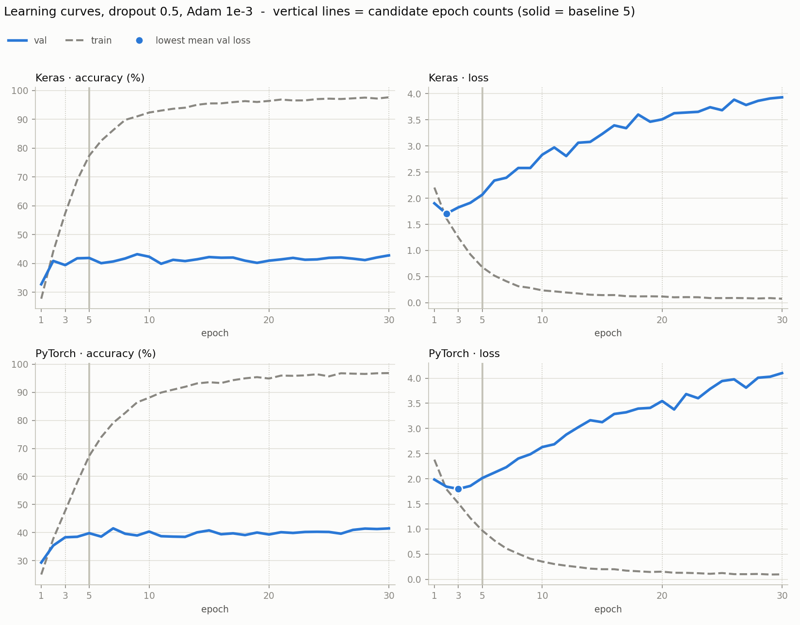
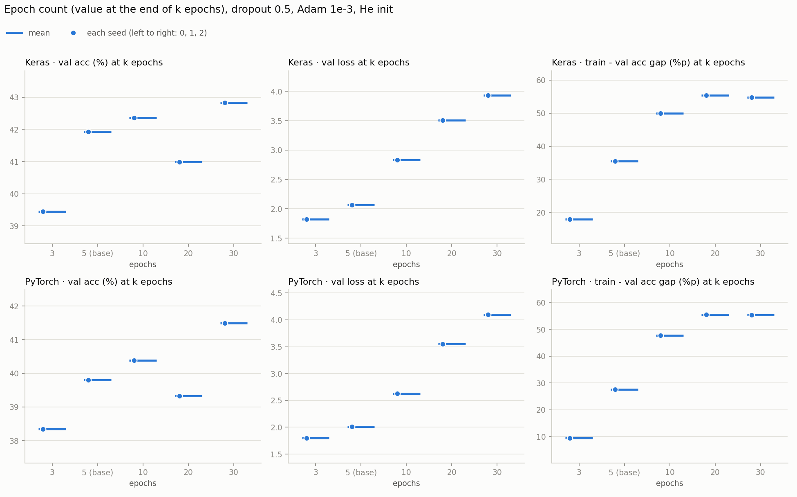

# 4단계 — 에폭 수 (시드 0, 30에폭) 와 얼리스탑 채택

3단계에서 PyTorch의 Dropout 0.75는 5에폭이 끝날 때도 val loss가 내려가는 중이었다. 5에폭이 짧아서 결과가 가려지고 있는지 보려고 에폭 수를 하나만 바꿔 봤다. 이 단계에서 얻은 결과로 **이후 단계부터 얼리스탑을 학습 방식으로 건다**는 결정도 했다 (아래 "얼리스탑 채택").

- 노트북: [`colab_v2/step4_epochs.ipynb`](../colab_v2/step4_epochs.ipynb)
- 실행일: 2026-11-09
- 조건: He 초기화, 2 Conv(32·64) + Dropout 0.5 + Dense(11), Adam 1e-3, batch 32, 증강 없음, 학습률 고정. 바꾼 것은 에폭 수 하나다 (5 → 30)
- 방법: 30에폭을 끝까지 돌린 한 번의 곡선에서 3 · 5(현재 기준선) · 10 · 20 · 30에폭 끝의 값을 비교했다. 학습률이 고정이고 조기 종료가 없어서, k에폭에서 멈춘 실행은 30에폭 실행의 앞 k에폭과 같은 길이다
- 시드 0 한 번 (프레임워크마다 1번, 합쳐 2번, 약 45분)

---

## 결과표

"그 에폭 끝에서 멈췄다면" 얻는 값이고 단위는 %다. val loss는 그 에폭 끝의 값이다. 최저 에폭은 1~k에폭 중 val loss가 가장 낮았던 에폭이다.

### Keras

| 에폭 수 | train acc | val acc | train − val %p | val loss | 최저 에폭 | test acc |
|---|---|---|---|---|---|---|
| 3 | 57.4 | 39.4 | 18.0 | 1.82 | 2 | 41.6 |
| 5 (기준선) | 77.4 | 41.9 | 35.5 | 2.07 | 2 | 46.0 |
| 10 | 92.4 | 42.4 | 50.0 | 2.83 | 2 | 46.0 |
| 20 | 96.4 | 41.0 | 55.4 | 3.51 | 2 | 45.7 |
| 30 | 97.7 | 42.8 | 54.8 | 3.93 | 2 | 46.4 |

곡선 전체(1~30에폭)에서 val loss 최저는 1.70(2에폭), val 정확도 최고는 43.2%(9에폭)다.

### PyTorch

| 에폭 수 | train acc | val acc | train − val %p | val loss | 최저 에폭 | test acc |
|---|---|---|---|---|---|---|
| 3 | 47.8 | 38.3 | 9.4 | 1.80 | 3 | 41.4 |
| 5 (기준선) | 67.3 | 39.8 | 27.5 | 2.01 | 3 | 42.7 |
| 10 | 88.1 | 40.4 | 47.7 | 2.63 | 3 | 44.9 |
| 20 | 94.9 | 39.3 | 55.6 | 3.55 | 3 | 43.8 |
| 30 | 96.8 | 41.5 | 55.4 | 4.10 | 3 | 45.5 |

곡선 전체에서 val loss 최저는 1.80(3에폭), val 정확도 최고는 41.5%(7에폭)다.

### 재현 확인

앞 5에폭은 3단계의 Dropout 0.5 시드 0 실행과 같은 설정이다. 재실행 흔들림(val 1~2%p) 안에서 맞았다.

| 프레임워크 | train acc | val acc | val loss |
|---|---|---|---|
| Keras | 77.4 (3단계 77.5, −0.1%p) | 41.9 (3단계 41.1, +0.8%p) | 2.07 (3단계 2.09, −0.02) |
| PyTorch | 67.3 (3단계 66.8, +0.5%p) | 39.8 (3단계 39.8, +0.0%p) | 2.01 (3단계 1.98, +0.03) |

### 기준선(5에폭 끝)과의 차이

같은 시드 0끼리 뺀 값이다 (k에폭 끝 − 5에폭 끝). val loss는 낮은 쪽이 낫다. 시드가 하나라서 판정하지 않았다.

| 에폭 수 | Keras val acc | Keras val loss | PyTorch val acc | PyTorch val loss |
|---|---|---|---|---|
| 3 | −2.5%p | −0.243 | −1.5%p | −0.217 |
| 10 | +0.4%p | +0.766 | +0.6%p | +0.616 |
| 20 | −0.9%p | +1.442 | −0.5%p | +1.532 |
| 30 | +0.9%p | +1.865 | +1.7%p | +2.088 |

4칸이 전부 5에폭보다 유리한 후보가 없다 (3에폭은 val loss만 낮고 val 정확도는 낮다. 10·20·30에폭은 val loss가 훨씬 높다).

### 그래프

30에폭 곡선이다. 왼쪽 열이 정확도(%), 오른쪽 열이 loss이고 위가 Keras, 아래가 PyTorch다. 파란 실선이 val, 회색 점선이 train이다. 세로선이 후보 에폭(3 · 5 · 10 · 20 · 30)이고 굵은 선이 기준선 5에폭이다. 파란 점이 val loss가 가장 낮았던 에폭(Keras 2, PyTorch 3)이다.

후보 에폭마다 그 에폭 끝의 val 정확도, val loss, train 대 val 격차를 찍은 그래프다 (시드 0 하나라 점도 하나다).

---

## 결론

**5에폭을 유지한다. 3시드는 돌리지 않았다.** 4칸 전부 유리한 후보가 없어서 3시드로 넘길 값이 없었다 (3단계와 같은 절차).

## 관찰

1. **병목은 에폭이 아니라 과적합이다.** train 정확도는 30에폭에 97%까지 오르는데 val 정확도는 3\~30에폭 사이에서 Keras 39.4\~42.8%, PyTorch 38.3\~41.5%로 평평하다 (같은 설정 재실행 흔들림 1\~2%p 안). 에폭을 늘려서 얻은 건 train 대 val 격차(55%p)뿐이다.
2. **val loss는 2~3에폭에서 바닥을 찍고 그 뒤로 오르기만 한다.** 30에폭에서 Keras 3.93, PyTorch 4.10이다. 외운 사진에 확신을 갖고 틀리는 정도가 커진다.
3. **5에폭은 짧은 게 아니라 val loss 바닥을 이미 지난 뒤다.** Keras 5에폭의 val loss 2.07은 바닥 1.70보다 높다. 이 설정(증강 없음, Dropout 0.5)에서는 에폭을 늘리는 쪽이 문제를 키운다.
4. **3단계에서 PyTorch 0.75가 5에폭까지 내려간 건 Dropout이 높아 학습이 느려진 탓이다.** 이 단계는 Dropout 0.5에서만 봤으므로 0.75에서 알맞은 에폭 수는 직접 보지 않았다.

---

## 얼리스탑 채택 (2026-11-09 결정)

위 곡선을 보면 val loss가 바닥일 때 멈추는 조기 종료(early stopping)를 걸면 어떻게 될지 궁금해진다. 30에폭 곡선을 따라 얼리스탑 규칙을 돌려 봤다 (새로 학습하지 않고 위 시드 0 곡선만 썼다. 학습률이 고정이라 얼리스탑이 걸린 실행은 이 곡선의 앞부분과 같은 길이라서 가능하다).

| 감시 값 | patience | Keras: 돌려주는 에폭 → val acc | PyTorch: 돌려주는 에폭 → val acc |
|---|---|---|---|
| val loss (최저 에폭 가중치로 복원) | 1 · 2 · 3 · 5 · 10 모두 | 2 → 40.9% (5에폭 대비 −1.0%p) | 3 → 38.3% (−1.5%p) |
| val acc (최고 에폭 가중치로 복원) | 1 / 2 / 3 / 5 / 10 | 2 / 5 / 5 / 9 / 9 | 5 / 7 / 7 / 7 / 7 |

- **val loss 감시는 patience와 상관없이 같은 에폭을 돌려주고, 그 모델의 정확도는 5에폭 기준선보다 낮다.** 대신 train 대 val 격차가 3.3%p(Keras) · 9.4%p(PyTorch)로 작다. 정확도 이득은 없다.
- **val acc 감시는 patience에 따라 돌려주는 에폭이 달라지고 고른 값에 선택 편향이 낀다.** Keras에서 5~30에폭의 val 정확도 평균은 41.5%(표준편차 0.8)인데 최고는 43.2%(9에폭)로 평균보다 +1.7%p(2.1 표준편차) 높다. 이 최고값 일부는 고른 데서 생긴 우연이다 (PyTorch도 평균 39.9% 대 최고 41.5%, +1.6%p).

**결정: 정확도를 올리려는 게 아니라, 이후 단계가 공정하게 비교되도록 얼리스탑을 학습 방식으로 건다.** 증강처럼 학습이 느린 설정은 5에폭에서 잘려 불리해지기 때문이다. 규칙은 다음과 같고, 기준선과 후보 모두에 똑같이 건다.

- 상한 30에폭
- val loss 감시. 최저를 갱신하지 못한 에폭이 5번 쌓이면(patience 5) 멈춘다. 갱신은 엄격히 낮아져야 한다 (min_delta 0)
- 멈추면 val loss가 가장 낮았던 에폭의 가중치로 되돌린다. 그 모델로 val · test · 증강 없는 train 정확도를 다시 잰다

앞 단계(He 초기화 · 학습률 · Dropout)의 결과는 "5에폭 기준"으로 그대로 둔다. 기준선도 5단계에서 이 방식으로 다시 쟀다.

이 방식의 약점도 알고 있다. val loss를 감시하면 val loss는 일찍 바닥인데 val 정확도는 계속 오르는 설정에서 이른 에폭을 돌려줘서 효과가 가려질 수 있다 ([5단계](step5_augmentation.md)의 Keras flip · zoom에서 그런 모습이 보였다).

---

## 한계

- 시드 0 한 번이다. 에폭 수 사이의 val 정확도 차이(최대 3.4%p)는 같은 설정을 다시 돌렸을 때의 흔들림(1~2%p)과 시드 범위에 걸쳐 있다.
- 증강이 없고 Dropout 0.5인 조건에서만 본 결과다. 증강이나 Dropout 0.75처럼 학습이 느린 설정에서는 알맞은 에폭 수가 더 길 수 있다.
- 얼리스탑 시뮬레이션은 시드 0의 한 곡선으로만 했다.

## 다음

학습 방식을 얼리스탑(상한 30 · val loss · patience 5)으로 바꾸고 증강을 하나씩 켜 본다 ([5단계](step5_augmentation.md)).
