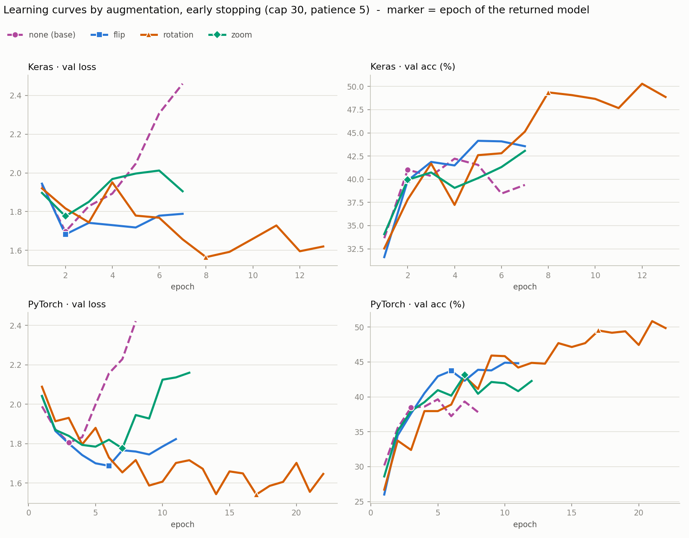
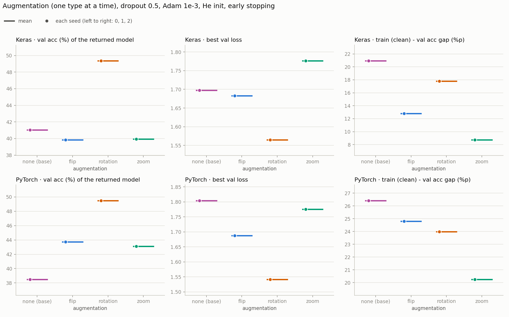
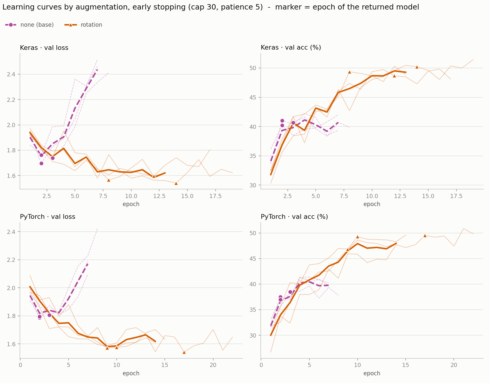
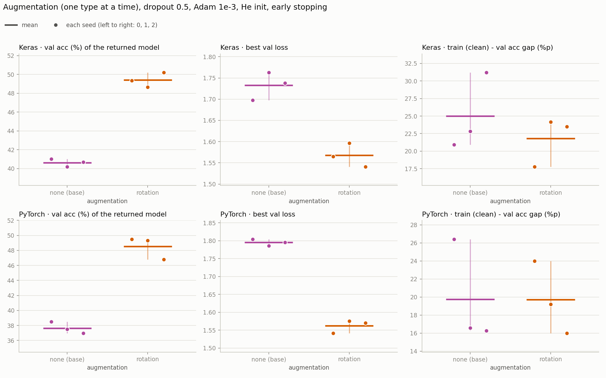

# 5단계 — 데이터 증강 (시드 0 훑어보기 8번 + 3시드 확인 8번)

4단계까지 보면 병목은 에폭이 아니라 과적합이다. 증강은 학습 이미지를 무작위로 변형해서 같은 사진을 외우기 어렵게 만드는 정규화다. 한 번에 하나만 바꾸는 원칙대로 증강 종류를 하나씩만 켰다. 이 단계부터 **학습 방식이 얼리스탑**이다 ([4단계](step4_epochs.md)의 결정).

- 노트북: [`colab_v2/step5_augmentation.ipynb`](../colab_v2/step5_augmentation.ipynb)
- 실행일: 2026-11-09 (시드 0 훑어보기와 3시드 확인 모두)
- 조건: He 초기화, 2 Conv(32·64) + Dropout 0.5 + Dense(11), Adam 1e-3, batch 32, 학습률 고정. **얼리스탑**: 상한 30에폭, val loss 감시, patience 5, 멈추면 val loss 최저 에폭의 가중치로 복원. 바꾼 것은 증강 종류 하나다 (none = 기준선 · flip · rotation · zoom)
- 훑어보기: 증강 4줄, 시드 0, 두 프레임워크 (8번, 약 75분)
- 3시드 확인: none과 rotation에 시드 1·2를 더했다. 시드 0은 훑어보기 결과를 그대로 썼다 (프레임워크마다 4번, 합쳐 8번)

## 증강의 정의

학습할 때만 켜고 검증 · 평가 때는 끈다. 파라미터가 없어서 모델 크기는 그대로다 (653,003개). 증강은 이미지를 128×128로 줄인 뒤에 건다.

| 줄 | 변형 | Keras | PyTorch |
|---|---|---|---|
| none | 증강 없음 (기준선) | | |
| flip | 좌우 반전 (확률 0.5) | `RandomFlip("horizontal")` | `RandomHorizontalFlip(0.5)` |
| rotation | ±20° 회전, 빈 곳은 검정 | `RandomRotation(20/360, fill_mode="constant")` | `RandomRotation(20, fill=0)` |
| zoom | 가운데 기준으로 최대 1.25배 확대 | `RandomZoom((-0.2, 0.0))` | `RandomAffine(0, scale=(1.0, 1.25))` |

**두 프레임워크의 증강을 맞췄다.** v1에서는 Keras가 ±36° 회전과 확대를, PyTorch가 ±10° 회전만 써서 서로 다른 증강이었다. 이번에는 종류 · 범위 · 보간(bilinear) · 빈 곳 채움(검정)을 같게 했다. 합성 이미지 600장으로 두 프레임워크가 만드는 분포를 쟀더니 같았다 (회전 각도 표준편차 11.4 대 11.7, 확대 배율 평균 1.115 대 1.123, 반전 비율 0.49 대 0.50). 남은 차이는 난수 발생기와 확대 배율의 표본 추출 방식(Keras는 배율의 역수를, PyTorch는 배율 자체를 균등하게 뽑는다)이고, 배율 평균이 0.01 다른 정도다. 확대만 쓰는 이유는 빈 곳 채움이 필요 없어서 채움 차이가 끼지 않기 때문이다.

---

## 결과표 — 시드 0 훑어보기

얼리스탑이 돌려준 모델(val loss 최저 에폭)의 값이고 단위는 %다. train acc는 증강 없이 다시 잰 값이라 줄끼리 비교할 수 있다. 멈춘 에폭은 최저 에폭보다 5 뒤다 (patience 5).

### Keras

| 증강 | train acc | val acc | train − val %p | val loss 최저 | 최저 에폭 | 멈춘 에폭 | test acc | 비고 |
|---|---|---|---|---|---|---|---|---|
| none | 62.0 | 41.0 | 20.9 | 1.70 | 2 | 7 | 43.1 | 기준선 |
| flip | 52.6 | 39.9 | 12.8 | 1.68 | 2 | 7 | 42.5 | |
| rotation | 67.1 | 49.4 | 17.8 | 1.57 | 8 | 13 | 50.4 | |
| zoom | 48.7 | 39.9 | 8.8 | 1.78 | 2 | 7 | 41.5 | |

### PyTorch

| 증강 | train acc | val acc | train − val %p | val loss 최저 | 최저 에폭 | 멈춘 에폭 | test acc | 비고 |
|---|---|---|---|---|---|---|---|---|
| none | 64.9 | 38.5 | 26.4 | 1.80 | 3 | 8 | 39.9 | 기준선 |
| flip | 68.5 | 43.7 | 24.8 | 1.69 | 6 | 11 | 45.9 | |
| rotation | 73.5 | 49.5 | 24.0 | 1.54 | 17 | 22 | 52.7 | |
| zoom | 63.4 | 43.1 | 20.2 | 1.78 | 7 | 12 | 44.7 | |

### 재현 확인

none 줄은 4단계 기준선과 같은 설정이고, 얼리스탑이 멈추기 전까지는 4단계 30에폭 곡선과 같은 길을 간다. 최저 에폭이 같고 값이 재실행 흔들림 안에서 맞았다.

| 프레임워크 | 최저 에폭 | val loss 최저 | 그 에폭의 val acc |
|---|---|---|---|
| Keras | 2 (4단계 2) | 1.70 (4단계 1.70, −0.01) | 41.0 (4단계 40.9, +0.1%p) |
| PyTorch | 3 (4단계 3) | 1.80 (4단계 1.80, +0.01) | 38.5 (4단계 38.3, +0.1%p) |

### none과의 차이

같은 시드 0끼리 뺀 값이다 (증강 − none). val loss는 낮은 쪽이 낫다. 시드가 하나라서 판정하지 않고 "4칸이 전부 none보다 유리한 줄만 3시드로 넘긴다"는 절차로 후보를 골랐다.

| 증강 | Keras val acc | Keras val loss | PyTorch val acc | PyTorch val loss | 4칸 모두 유리? |
|---|---|---|---|---|---|
| flip | −1.2%p | −0.015 | +5.2%p | −0.117 | 아니오 (Keras val acc) |
| rotation | **+8.3%p** | **−0.132** | **+11.0%p** | **−0.263** | **예** |
| zoom | −1.1%p | +0.079 | +4.6%p | −0.029 | 아니오 (Keras 둘 다) |

rotation만 4칸이 전부 유리해서 3시드로 넘겼다. flip과 zoom은 PyTorch에서만 효과가 있었고 Keras에서는 없었다.

### 그래프 (시드 0)

증강 줄마다 색이 하나다 (점선 = 기준선 none). 왼쪽 열이 val loss, 오른쪽 열이 val 정확도(%)이고 위가 Keras, 아래가 PyTorch다. 표시가 얼리스탑이 돌려준 에폭이다. none은 2~3에폭에서 바닥을 찍고 val loss가 오르며 멈추는데, rotation은 val loss가 훨씬 오래 내려가고 val 정확도가 계속 오른다 (Keras 8에폭, PyTorch 17에폭에서 돌려줌).

줄마다 얼리스탑이 돌려준 모델의 val 정확도, 최저 val loss, train 대 val 격차를 점으로 찍은 그래프다 (시드 0 하나라 점도 하나다).

---

## 결과표 — 3시드 확인 (none 대 rotation)

얼리스탑이 돌려준 모델의 값이고 단위는 %다. 평균 [최소~최대]이고, 최저 에폭과 멈춘 에폭은 시드 평균이다.

### Keras

| 증강 | train acc | val acc | train − val %p | val loss 최저 | 최저 에폭 | 멈춘 에폭 | test acc |
|---|---|---|---|---|---|---|---|
| none (기준선) | 65.6 [62.0~71.9] | 40.6 [40.2~41.0] | 25.0 [20.9~31.2] | 1.73 [1.70~1.76] | 2.3 [2.0~3.0] | 7.3 [7.0~8.0] | 43.0 [42.5~43.3] |
| rotation | 71.2 [67.1~73.7] | 49.4 [48.7~50.2] | 21.8 [17.8~24.1] | 1.57 [1.54~1.60] | 11.3 [8.0~14.0] | 16.3 [13.0~19.0] | 51.5 [50.4~52.6] |

### PyTorch

| 증강 | train acc | val acc | train − val %p | val loss 최저 | 최저 에폭 | 멈춘 에폭 | test acc |
|---|---|---|---|---|---|---|---|
| none (기준선) | 57.4 [53.2~64.9] | 37.6 [37.0~38.5] | 19.8 [16.3~26.4] | 1.80 [1.79~1.80] | 2.3 [2.0~3.0] | 7.3 [7.0~8.0] | 38.9 [37.7~39.9] |
| rotation | 68.3 [62.8~73.5] | 48.5 [46.8~49.5] | 19.7 [16.0~24.0] | 1.56 [1.54~1.58] | 12.0 [9.0~17.0] | 17.0 [14.0~22.0] | 51.0 [49.2~52.7] |

시드 0의 none 줄은 4단계와 맞았다 (위 재현 확인). 시드 1·2의 none은 4단계에 같은 실행이 없어서 비교하지 못했다.

### 그래프 (3시드)

연한 선이 시드 하나, 굵은 선이 평균이고 점선이 none이다. 표시가 얼리스탑이 돌려준 에폭이다. none은 시드 3개 모두 2~3에폭에서 바닥이고 이후 val loss가 2.2~2.5까지 치솟는다. rotation은 바닥이 Keras 8~14에폭, PyTorch 9~17에폭이고 val 정확도가 그동안 계속 오른다.

위 줄이 Keras, 아래 줄이 PyTorch이고, 열은 왼쪽부터 얼리스탑이 돌려준 모델의 val 정확도(%), 최저 val loss, train 대 val 격차(%p)다. 점 하나가 시드 하나이고 같은 시드는 같은 가로 위치에 있다 (왼쪽부터 시드 0·1·2). 짧은 가로선이 3시드 평균이고 세로선이 최소~최대다. val 정확도와 val loss 두 열에서는 rotation의 점 세 개가 none의 점 세 개와 전혀 겹치지 않는다.

---

## 판정 규칙 (결과를 보기 전에 노트북에 적어 둔 것)

2~3단계와 같다. 같은 시드끼리 뺀 값이 시드 전부에서 같은 방향이고, 평균 차이가 시드 범위(두 조건의 최대−최소 중 큰 쪽)보다 클 때만 "뚜렷함"으로 읽는다. 비교하는 값은 **얼리스탑이 돌려준 모델의 val 정확도와 val loss**다. val acc와 val loss 둘 다, 두 프레임워크 모두(4칸 전부)에서 증강이 뚜렷하게 앞설 때만 그 증강을 기준선에 넣는다. 하나라도 아니면 증강 없음을 유지한다. 고르는 건 val이고 test는 보고용이다.

| 프레임워크 | 지표 | 차이 (rotation − none) | 시드별 (0 · 1 · 2) | 시드 범위 | 판정 |
|---|---|---|---|---|---|
| Keras | val acc | +8.8%p | +8.3 · +8.5 · +9.5 | 1.5 | **rotation 우세 (뚜렷함)** |
| Keras | val loss 최저 | −0.165 | −0.132 · −0.166 · −0.197 | 0.066 | **rotation 우세 (뚜렷함)** |
| PyTorch | val acc | +10.9%p | +11.0 · +11.8 · +9.8 | 2.7 | **rotation 우세 (뚜렷함)** |
| PyTorch | val loss 최저 | −0.233 | −0.263 · −0.211 · −0.226 | 0.034 | **rotation 우세 (뚜렷함)** |

보고용 지표 (판정에 쓰지 않았다):

| 프레임워크 | train − val 격차 | test acc | 최저 에폭 |
|---|---|---|---|
| Keras | −3.2%p (−3.1 · +1.3 · −7.7, 시드 범위 10.3) | +8.5%p (+7.3 · +9.0 · +9.3, 시드 범위 2.1) | +9.0에폭 (+6 · +10 · +11) |
| PyTorch | −0.0%p (−2.4 · +2.6 · −0.3, 시드 범위 10.2) | +12.1%p (+12.8 · +11.8 · +11.5, 시드 범위 3.4) | +9.7에폭 (+14 · +8 · +7) |

**결론: 증강 rotation(±20°)을 기준선에 넣는다.** 4칸 전부에서 뚜렷하게 앞섰다. 새 기준선은 He 초기화 + 2 Conv(32·64) + Dropout 0.5 + Dense(11) + Adam 1e-3 + rotation ±20° + 얼리스탑이다.

---

## 관찰

1. **rotation은 시드 3개 전부, 두 프레임워크 모두에서 같은 방향으로 뚜렷하게 앞섰다.** 평균 차이가 시드 범위의 2.5~7배다 (가장 얇은 칸이 Keras val loss의 2.5배). 4칸 모두 rotation의 가장 나쁜 시드가 none의 가장 좋은 시드보다도 낫다 (예: Keras val 정확도 rotation 48.7~50.2 대 none 40.2~41.0). test도 같은 방향이다 (+8.5, +12.1%p, 보고용).
2. **rotation은 과적합이 시작되는 시점을 뒤로 민다.** val loss 바닥이 2~3에폭에서 11~12에폭으로 약 9~10에폭 늦춰졌고, 얼리스탑이 멈추는 에폭도 7에서 16~17로 늘었다. 그동안 val 정확도가 약 49%까지 계속 올랐다.
3. **train 대 val 격차는 거의 줄지 않았다.** Keras −3.2%p, PyTorch −0.0%p이고 시드 범위가 10%p라 구분되지 않는다. 되돌려진 모델의 에폭이 서로 달라서 격차끼리 단순 비교가 안 되고, 증강 없이 잰 train 정확도도 같이 올랐다 (Keras 65.6 → 71.2, PyTorch 57.4 → 68.3). "격차를 줄였다"보다 "과적합이 시작되기 전까지 더 오래, 더 많이 배운다"로 읽는 편이 맞다.
4. **얼리스탑 감시가 none을 불리하게 만들지는 않았다.** 4단계 시드 0 곡선에서 none의 val 정확도는 5~30에폭 내내 38~43%로 평평했다. 어느 에폭을 돌려받아도 rotation의 48~50%에 못 미친다.
5. **flip과 zoom은 시드 0에서 PyTorch에서만 효과가 있었다** (val 정확도 +5.2%p, +4.6%p). Keras에서는 효과가 없었다 (−1.2%p, −1.1%p). Keras는 val loss 감시 얼리스탑이 바닥인 2에폭을 돌려주는데, 곡선에서는 flip이 5~6에폭, zoom이 7에폭에서 val 정확도가 약 43~44%까지 올랐다. 감시 방식이 효과를 가렸을 수 있다. 시드 0 한 번의 관찰이라 결론으로 쓰지 않는다.
6. **시드 사이 흔들림이 있다.** 3시드 val 정확도의 시드 범위는 Keras none 0.8 · rotation 1.5, PyTorch none 1.5 · rotation 2.7%p다.
7. **두 프레임워크가 같은 방향이다.** rotation의 4칸이 모두 같은 쪽으로 나왔다.

### 노트북에 적어 둔 예상 6개와 비교

1. 증강 줄은 기준선보다 늦게 멈출 것이다 — rotation은 맞았다 (최저 에폭 +9.0, +9.7에폭). flip과 zoom은 PyTorch에서만 맞았고 Keras에서는 2에폭 그대로였다.
2. val loss 최저가 기준선보다 낮아질 것이다 — rotation은 맞았다. flip과 zoom은 PyTorch에서만 낮아졌다 (zoom은 Keras에서 오히려 높아졌다).
3. val 정확도는 오르되 크기는 작을 수 있다 (+2~4%p, 시드 범위 안) — **틀렸다.** rotation이 +8.8, +10.9%p로 컸고 뚜렷했다.
4. flip이 가장 약한 변형일 것이다 — **맞지 않았다.** 시드 0에서 Keras는 flip과 zoom이 둘 다 효과가 없었고, PyTorch는 flip(+5.2)이 zoom(+4.6)보다 컸다.
5. 증강 없는 train 기준 격차가 기준선보다 줄 것이다 — **틀렸다.** rotation의 격차 변화는 시드 범위 안이었다 (위 관찰 3).
6. 두 프레임워크에서 같은 방향이 나올 것이다 — rotation은 맞았다. flip과 zoom은 시드 0에서 프레임워크가 갈렸다.

---

## 한계

- **강도는 한 값만 봤다.** 회전 ±20°, 확대 1.25배 하나씩이다. 다른 강도는 보지 않았다.
- **3시드 확인은 none과 rotation만 했다.** flip과 zoom은 시드 0 한 번의 관찰이다. 위 관찰 5처럼 Keras에서는 감시 방식이 효과를 가렸을 수 있어서, 이 두 줄은 "효과 없음"이 아니라 "이 프로토콜로는 못 봤다"이다.
- **val loss를 감시하는 얼리스탑은 val loss가 일찍 바닥인데 val 정확도는 계속 오르는 설정의 효과를 가릴 수 있다.** 이 단계의 모든 줄에 똑같이 걸어서 줄 사이 비교는 공정하지만, 줄마다 놓치는 정도는 다를 수 있다.
- **조합은 보지 않았다.** flip + rotation + zoom을 한꺼번에 켠 경우는 이 단계에서 보지 않았다.
- **He · 학습률 · Dropout 결과는 5에폭 기준이다.** rotation을 넣으면 학습이 11~17에폭까지 이어져서 알맞은 Dropout 값이 달라질 수 있다.
- 시드 3개다. 시드 0은 훑어보기 실행 결과를 재사용했다 (GPU 비결정성의 영향).
- 후보를 고르는 데 val을 썼다. test는 보고용이다.

## 다음

rotation이 새 기준선이 됐다. 남은 확인은 두 가지다. ① rotation 기준선에서 Dropout 0.5 대 0.75를 얼리스탑 아래에서 3시드로 다시 본다 (3단계의 결론은 증강이 없고 5에폭 고정인 조건에서 나왔다). ② 증강 세 가지를 전부 켠 쪽(v1 방식)과 rotation 하나를 3시드로 비교한다. 결과는 이 폴더에 이어서 추가한다.
