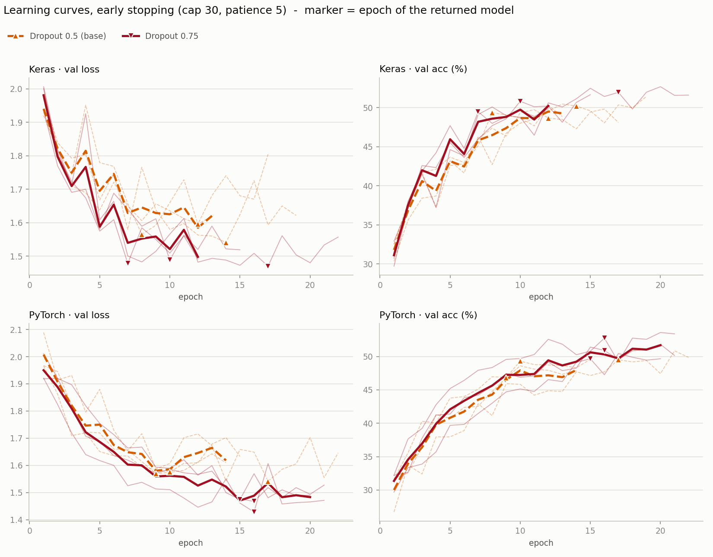
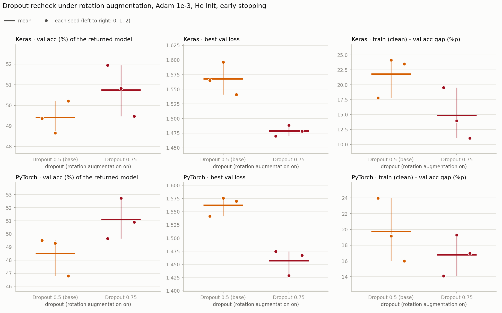

# 6단계 — Dropout 재확인 (rotation 기준선, 3시드 6번)

3단계의 결론(Dropout 0.5 유지)은 증강이 없고 5에폭으로 고정한 조건에서 나왔고, PyTorch의 0.75는 5에폭이 끝날 때도 val loss가 내려가는 중이라 5에폭 한계가 섞여 있었다. 그 뒤로 학습 방식(얼리스탑)과 기준선(증강 rotation ±20°)이 바뀌었다. 이 단계는 같은 질문을 **지금의 기준선에서 한 번 더** 본다. 3단계에서 후보로 남았던 0.75가 rotation 증강과 얼리스탑 아래에서도 0.5보다 나은가.

- 노트북: [`colab_v2/step6_dropout_recheck.ipynb`](../colab_v2/step6_dropout_recheck.ipynb)
- 실행일: 2026-11-10
- 조건: He 초기화, 2 Conv(32·64) + Dropout + Dense(11), Adam 1e-3, batch 32, 학습률 고정, **증강 rotation ±20°**, **얼리스탑** (상한 30에폭, val loss 감시, patience 5, 멈추면 val loss 최저 에폭의 가중치로 복원). 바꾼 것은 Dropout 비율 하나다 (0.5 → 0.75).
- 실행: 0.75 줄 3시드 × 두 프레임워크 = 6번 (어림 약 96분). 훑어보기 없이 바로 3시드로 갔다 (3단계에서 0.75가 이미 후보로 남았기 때문이다).
- 비교 기준 줄: **Dropout 0.5 + rotation**은 [5단계](step5_augmentation.md)가 이미 3시드로 돌려 둔 결과(`food11_v2_aug.csv`)를 그대로 가져왔다. 다시 돌리지 않았다.

**기준선 줄을 다시 돌리지 않아도 되는 이유.** 5단계의 rotation 줄과 이 노트북의 0.75 줄은 코드가 같다. 5단계 셀에서 바뀐 것은 ① Dropout 비율을 인자로 받는 것 ② 결과 기록과 "끝난 실행 건너뛰기"의 키에 Dropout 값을 넣는 것 ③ 실행 루프가 설정(`CANDS`)을 따르는 것, 이 세 가지뿐이다. 모델 구조, 초기화, 옵티마이저, 얼리스탑, 증강, 데이터 불러오기는 그대로다. 같은 시드면 첫 가중치와 데이터 순서, 증강에 쓰는 난수열이 같고 Dropout 비율만 다르다 (GPU 연산 순서 때문에 값이 완전히 같게 재현되지는 않는다).

---

## 결과표

얼리스탑이 돌려준 모델(val loss 최저 에폭)의 값이고 단위는 %다. 평균 [최소~최대]이고, 최저 에폭과 멈춘 에폭은 시드 평균이다. train acc는 증강 없이 다시 잰 값이다. Dropout 0.5 줄은 5단계의 rotation 줄과 같은 값이다.

### Keras

| Dropout | train acc | val acc | train − val %p | val loss 최저 | 최저 에폭 | 멈춘 에폭 | test acc | 비고 |
|---|---|---|---|---|---|---|---|---|
| 0.5 | 71.2 [67.1~73.7] | 49.4 [48.7~50.2] | 21.8 [17.8~24.1] | 1.57 [1.54~1.60] | 11.3 [8.0~14.0] | 16.3 [13.0~19.0] | 51.5 [50.4~52.6] | 기준선 |
| 0.75 | 65.6 [60.6~71.5] | 50.7 [49.5~52.0] | 14.9 [11.1~19.5] | 1.48 [1.47~1.49] | 11.3 [7.0~17.0] | 16.3 [12.0~22.0] | 52.9 [51.8~54.3] | |

### PyTorch

| Dropout | train acc | val acc | train − val %p | val loss 최저 | 최저 에폭 | 멈춘 에폭 | test acc | 비고 |
|---|---|---|---|---|---|---|---|---|
| 0.5 | 68.3 [62.8~73.5] | 48.5 [46.8~49.5] | 19.7 [16.0~24.0] | 1.56 [1.54~1.58] | 12.0 [9.0~17.0] | 17.0 [14.0~22.0] | 51.0 [49.2~52.7] | 기준선 |
| 0.75 | 67.9 [63.8~72.0] | 51.1 [49.7~52.7] | 16.8 [14.1~19.3] | 1.46 [1.43~1.47] | 15.7 [15.0~16.0] | 20.7 [20.0~21.0] | 53.7 [52.9~55.3] | |

### 그래프

줄마다 색이 하나다 (점선 = 기준선 Dropout 0.5). 왼쪽 열이 val loss, 오른쪽 열이 val 정확도(%)이고 위가 Keras, 아래가 PyTorch다. 연한 선이 시드 하나, 굵은 선이 평균이고 표시(▲ ▼)가 얼리스탑이 돌려준 에폭이다. 굵은 평균 선은 그 줄에서 가장 먼저 멈춘 시드의 에폭까지만 그려진다. 0.75의 평균 val loss 곡선이 두 프레임워크 모두 거의 모든 에폭에서 0.5보다 아래에 있고, val 정확도 평균 곡선도 대체로 위에 있다. PyTorch 0.75는 시드 3개 모두 15\~16에폭에서 돌려받았다 (0.5는 9\~17에폭).

위 줄이 Keras, 아래 줄이 PyTorch이고, 열은 왼쪽부터 얼리스탑이 돌려준 모델의 val 정확도(%), 최저 val loss, train(증강 없이 잼) 대 val 격차(%p)다. 점 하나가 시드 하나이고 같은 시드는 같은 가로 위치에 있다 (왼쪽부터 시드 0·1·2). 짧은 가로선이 3시드 평균이고 세로선이 최소~최대다. val loss 열에서는 두 프레임워크 모두 0.75의 점 세 개가 0.5의 점 세 개와 전혀 겹치지 않는다. val 정확도 열에서는 Keras가 겹치고, PyTorch는 0.5의 최고 49.5와 0.75의 최저 49.7이 거의 맞닿는다.

---

## 판정 규칙 (결과를 보기 전에 노트북에 적어 둔 것)

이전 단계와 같다. 같은 시드끼리 뺀 값이 시드 전부에서 같은 방향이고, 평균 차이가 시드 범위(두 조건의 최대−최소 중 큰 쪽)보다 클 때만 "뚜렷함"으로 읽는다. 비교하는 값은 **얼리스탑이 돌려준 모델의 val 정확도와 val loss**다. val acc와 val loss 둘 다, 두 프레임워크 모두(4칸 전부)에서 0.75가 뚜렷하게 앞설 때만 Dropout을 0.75로 바꾼다. 하나라도 아니면 0.5를 유지한다. 4칸 전부에서 0.5가 뚜렷하게 낫다면 "기준선이 뚜렷하게 낫다"로 적는다. 고르는 건 val이고 test는 보고용이다. 0.75가 채택되면 다음 단계(7단계)를 0.75에서 돌리고, 아니면 0.5 그대로 돌린다.

같은 시드끼리 뺀 값 (0.75 − 0.5)이다. val loss는 낮은 쪽이 낫다.

| 프레임워크 | 지표 | 차이 (0.75 − 0.5) | 시드별 (0 · 1 · 2) | 시드 범위 | 판정 |
|---|---|---|---|---|---|
| Keras | val acc | +1.3%p | +2.6 · +2.2 · −0.7 | 2.5 | 구분 안 됨 (시드마다 방향이 다름, 0.75 우세 2/3) |
| Keras | val loss 최저 | −0.088 | −0.095 · −0.108 · −0.062 | 0.055 | **0.75 우세 (뚜렷함)** |
| PyTorch | val acc | +2.6%p | +0.1 · +3.4 · +4.1 | 3.1 | 구분 안 됨 (방향은 같지만 평균 차이가 시드 범위 안) |
| PyTorch | val loss 최저 | −0.105 | −0.067 · −0.147 · −0.102 | 0.046 | **0.75 우세 (뚜렷함)** |

보고용 지표 (판정에 쓰지 않았다):

| 프레임워크 | train − val 격차 | test acc | 최저 에폭 |
|---|---|---|---|
| Keras | −7.0%p (+1.7 · −10.2 · −12.4, 시드 범위 8.4) | +1.5%p (+3.9 · +1.2 · −0.7, 시드 범위 2.5) | +0.0에폭 (+9 · −2 · −7) |
| PyTorch | −2.9%p (−9.9 · +0.1 · +1.0, 시드 범위 8.0) | +2.7%p (+0.2 · +4.3 · +3.7, 시드 범위 3.4) | +3.7에폭 (−2 · +6 · +7) |

**결론: Dropout 0.5를 유지한다.** 0.75는 4칸 중 2칸(두 프레임워크의 val loss 최저)에서만 뚜렷하게 앞섰고, val 정확도 두 칸은 구분되지 않았다. 기준선이 앞선 칸은 없다 (0.75 우세 2칸 · 기준선 우세 0칸 · 구분 안 됨 2칸). 7단계는 Dropout 0.5 그대로 돌렸다.

---

## 관찰

1. **3단계와 같은 모양이다.** val loss 최저는 두 프레임워크 모두 시드 3개 전부에서 0.75가 낮고, 평균 차이가 시드 범위의 1.6배(Keras), 2.3배(PyTorch)다. 0.75의 가장 나쁜 시드도 0.5의 가장 좋은 시드보다 낮다 (Keras 1.49 대 1.54, PyTorch 1.47 대 1.54). 반면 val 정확도는 0.75가 평균에서 높지만(+1.3, +2.6%p) 시드 범위(2.5, 3.1) 안이다. Keras는 시드 하나가 반대로 나왔다 (−0.7). 3단계에서도 4칸 중 2칸만 뚜렷했다.
2. **"차이 없음"이 아니라 "3시드로는 정확도 차이를 못 가름"이다.** 0.75의 val 정확도 평균은 두 프레임워크 모두 높았고 PyTorch는 시드 3개 전부 같은 방향이다 (+0.1, +3.4, +4.1). 하지만 시드 3개로 가려낼 수 있는 차이는 대략 3~4%p 이상이고 이번 차이는 그 아래다. 0.5의 최고(49.5)와 0.75의 최저(49.7)가 맞닿은 PyTorch의 점 배치도 3 대 3에서는 어느 쪽으로든 완전히 갈릴 확률이 10%라서, 규칙대로 "구분 안 됨"으로 둔다.
3. **rotation이 이미 정규화를 해 둬서 Dropout이 더하는 효과는 3단계보다 작았다.** train 대 val 격차의 감소가 3단계(증강 없음, 5에폭 끝)에서는 Keras −17.8%p, PyTorch −15.1%p였는데 이번에는 −7.0, −2.9%p이고 시드 범위(8.4, 8.0) 안이다 (측정 조건이 달라서 단순 비교는 아니다). val 정확도 이득은 Keras에서 +3.7 → +1.3%p로 줄었고, PyTorch는 +2.1 → +2.6%p로 비슷했다.
4. **0.75는 Keras에서는 학습을 늦추지 않았고 PyTorch에서는 늦췄다.** 최저 에폭이 Keras 11.3 → 11.3, PyTorch 12.0 → 15.7이다. 멈춘 에폭은 최대 22로, 상한 30에폭에 닿은 실행이 없다.
5. **test도 같은 방향이다 (보고용).** Keras +1.5%p, PyTorch +2.7%p이고 둘 다 시드 범위(2.5, 3.4) 안이다.
6. **두 프레임워크가 같은 방향이다.** val loss 두 칸은 같은 쪽으로 뚜렷하고, val 정확도 두 칸도 0.75가 높은 쪽이다 (구분은 안 됨).

### 노트북에 적어 둔 예상 4개와 비교

1. rotation이 이미 정규화를 해서 Dropout으로 추가로 얻는 것은 3단계보다 작거나 없을 수 있다 — 반쯤 맞았다. 격차를 줄이는 효과는 작아졌고(관찰 3), val 정확도 이득은 Keras에서만 줄었다 (PyTorch는 비슷).
2. 0.75는 학습을 더 늦춘다 — PyTorch에서만 맞았다 (최저 에폭 +3.7). Keras는 같았다 (+0.0). 상한 30에폭에 닿은 실행은 없었다.
3. 정규화가 이미 충분한 모델에서 비율을 더 올리면 덜 배워서 val 정확도가 내려갈 수도 있다 — 나타나지 않았다. val 정확도 평균이 두 프레임워크 모두 올랐다. 증강 없이 잰 train 정확도는 Keras에서만 내려갔다 (71.2 → 65.6, PyTorch는 68.3 → 67.9).
4. 두 프레임워크가 같은 방향이 나올지는 모른다 — 같은 방향이었다 (관찰 6).

---

## 한계

- **값은 0.5와 0.75 둘만 봤다.** rotation이 정규화를 이미 더하므로 더 낮은 값(0.25 등)이 나을 수도 있다. 이번에는 3단계에서 후보로 남은 0.75만 확인했다.
- **증강은 rotation ±20° 한 값이다.** 증강 정책끼리의 비교는 [7단계](step7_aug_all.md)에서 따로 봤다.
- **"0.75가 낫지 않다"가 아니라 "이 프로토콜로는 낫다고 말할 수 없다"이다.** val loss는 뚜렷하게 낮았지만 val loss가 낮다고 정확도가 높다는 보장은 없고, 정확도는 3시드로 가려지지 않았다. 규칙(4칸 전부)을 통과하지 못해서 더 단순한 쪽(기준선)을 남겼다.
- 비교 기준 줄(Dropout 0.5)은 하루 전(5단계)에 돌린 결과를 가져왔다. 코드와 시드는 같지만 GPU 비결정성의 영향을 받는다.
- 학습률과 He 초기화의 결론은 여전히 5에폭 기준이다 (순차 튜닝의 한계, 설정끼리의 상호작용은 못 본다).
- 시드 3개다. 후보를 고르는 데 val을 썼고 test는 보고용이다.

## 다음

Dropout 0.5가 유지돼서 [7단계](step7_aug_all.md)는 Dropout 0.5 그대로 돌렸다.
