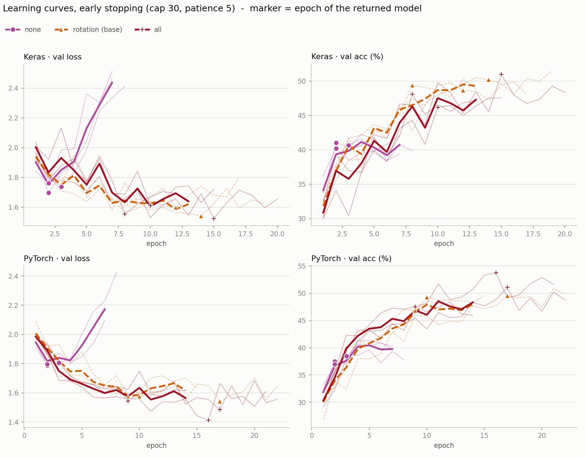
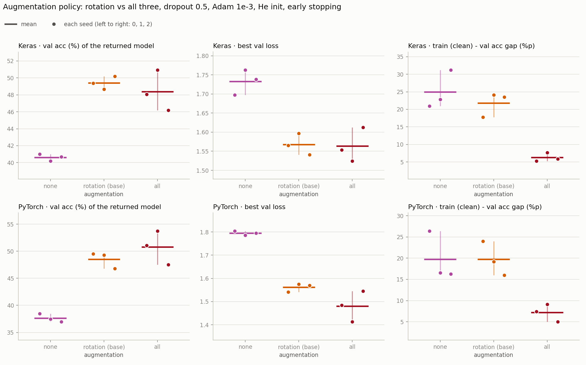

# 7단계 — v1 방식 재현 비교: 증강 세 가지를 전부 켠 쪽 대 rotation (3시드 6번)

v1에서는 증강을 한꺼번에 여러 개 켰다 (Keras는 좌우 반전 + ±36° 회전 + 확대, PyTorch는 좌우 반전 + ±10° 회전). v2는 [5단계](step5_augmentation.md)에서 증강을 하나씩 켜 보고 rotation(±20°)만 기준선에 넣었다. 이 단계는 마지막 비교로, v1처럼 세 가지를 전부 켠 쪽(all)과 rotation만 켠 기준선을 3시드로 맞붙인다. 두 프레임워크의 증강은 5단계에서 맞춘 그대로라서, v1의 강도가 아니라 **v1의 방식(전부 켜기)을 같은 조건에서 다시 보는 것**이다.

- 노트북: [`colab_v2/step7_aug_all.ipynb`](../colab_v2/step7_aug_all.ipynb)
- 실행일: 2026-11-10
- 조건: He 초기화, 2 Conv(32·64) + Dropout 0.5 + Dense(11), Adam 1e-3, batch 32, 학습률 고정, **얼리스탑** (상한 30에폭, val loss 감시, patience 5, 멈추면 val loss 최저 에폭의 가중치로 복원). Dropout은 [6단계](step6_dropout_recheck.md) 결론대로 0.5다. 바꾼 것은 증강 하나다 (rotation → all).
- 실행: all 줄 3시드 × 두 프레임워크 = 6번 (어림 약 114분).
- 비교 기준 줄: **rotation**은 5단계가 이미 3시드로 돌려 둔 결과(`food11_v2_aug.csv`)를 그대로 가져왔다. 다시 돌리지 않았다. 참고로 none(증강 없음)도 같은 파일에서 가져와 같이 보여 주고, 판정에는 쓰지 않았다.

**기준선 줄을 다시 돌리지 않아도 되는 이유.** 6단계와 같다. 5단계 셀에서 바뀐 것은 ① 줄 이름 `all` 추가 (증강 정의가 세 변형을 차례로 쌓는다) ② Dropout 비율을 인자로 받고 결과 기록과 "끝난 실행 건너뛰기"의 키에 넣는 것 ③ 실행 루프가 설정(`CANDS`)을 따르는 것이다. 모델 구조, 초기화, 옵티마이저, 얼리스탑, 데이터 불러오기는 그대로라서 5단계에서 가져온 rotation 줄과 같은 조건이다.

## all의 정의

세 변형을 한 이미지에 차례로 건다 (flip → rotation → zoom). 학습할 때만 켜고 검증 · 평가 때는 끈다. 파라미터가 없어서 모델 크기는 그대로다 (653,003개). 각 변형의 강도는 단독 줄과 같다 (반전 확률 0.5, ±20° 회전, 최대 1.25배 확대).

| 줄 | 변형 | Keras | PyTorch |
|---|---|---|---|
| rotation (기준선) | ±20° 회전, 빈 곳은 검정 | `RandomRotation(20/360, fill_mode="constant")` | `RandomRotation(20, fill=0)` |
| all | 좌우 반전 + ±20° 회전 + 최대 1.25배 확대 | `RandomFlip` → `RandomRotation` → `RandomZoom` | `RandomHorizontalFlip` → `RandomRotation` → `RandomAffine(scale)` |

**변형마다 따로 무작위로 뽑는다.** Keras는 층마다 시드를 다르게 줬다. 같은 시드를 세 층에 주면 세 층이 같은 난수열을 써서 반전 · 회전 · 확대가 서로 묶인다. 합성 이미지 2,000장(막대 + 점)으로 쟀다.

| | 반전 비율 | 회전 각도 표준편차 | 확대 배율 평균 | 상관계수 (반전↔회전 · 반전↔확대 · 회전↔확대) |
|---|---|---|---|---|
| Keras, 층마다 다른 시드 (7단계) | 0.504 | 11.1 | 1.116 | −0.04 · −0.01 · −0.02 |
| PyTorch | 0.513 | 11.2 | 1.124 | −0.03 · +0.01 · +0.02 |
| Keras, 세 층에 같은 시드 (쓰지 않았다) | 0.504 | 10.3 | 1.121 | +0.88 · +0.86 · +0.99 |

두 프레임워크의 분포가 같고 변형 사이에 상관이 없다 (표본 오차 약 ±0.05). 같은 시드를 주면 반전이 걸리지 않은 이미지는 전부 한쪽으로만 회전하는 식으로 묶여서 "각각 무작위"가 아니다.

---

## 결과표

얼리스탑이 돌려준 모델(val loss 최저 에폭)의 값이고 단위는 %다. 평균 [최소~최대]이고, 최저 에폭과 멈춘 에폭은 시드 평균이다. train acc는 증강 없이 다시 잰 값이라 줄끼리 비교할 수 있다. none과 rotation 줄은 5단계의 값이다.

### Keras

| 증강 | train acc | val acc | train − val %p | val loss 최저 | 최저 에폭 | 멈춘 에폭 | test acc | 비고 |
|---|---|---|---|---|---|---|---|---|
| none | 65.6 [62.0~71.9] | 40.6 [40.2~41.0] | 25.0 [20.9~31.2] | 1.73 [1.70~1.76] | 2.3 [2.0~3.0] | 7.3 [7.0~8.0] | 43.0 [42.5~43.3] | 참고 (판정 제외) |
| rotation | 71.2 [67.1~73.7] | 49.4 [48.7~50.2] | 21.8 [17.8~24.1] | 1.57 [1.54~1.60] | 11.3 [8.0~14.0] | 16.3 [13.0~19.0] | 51.5 [50.4~52.6] | 기준선 |
| all | 54.7 [52.1~58.6] | 48.4 [46.2~50.9] | 6.3 [5.3~7.7] | 1.56 [1.52~1.61] | 11.0 [8.0~15.0] | 16.0 [13.0~20.0] | 50.4 [48.0~53.2] | |

### PyTorch

| 증강 | train acc | val acc | train − val %p | val loss 최저 | 최저 에폭 | 멈춘 에폭 | test acc | 비고 |
|---|---|---|---|---|---|---|---|---|
| none | 57.4 [53.2~64.9] | 37.6 [37.0~38.5] | 19.8 [16.3~26.4] | 1.80 [1.79~1.80] | 2.3 [2.0~3.0] | 7.3 [7.0~8.0] | 38.9 [37.7~39.9] | 참고 (판정 제외) |
| rotation | 68.3 [62.8~73.5] | 48.5 [46.8~49.5] | 19.7 [16.0~24.0] | 1.56 [1.54~1.58] | 12.0 [9.0~17.0] | 17.0 [14.0~22.0] | 51.0 [49.2~52.7] | 기준선 |
| all | 58.0 [52.5~62.9] | 50.8 [47.5~53.8] | 7.2 [5.0~9.1] | 1.48 [1.41~1.54] | 14.0 [9.0~17.0] | 19.0 [14.0~22.0] | 52.3 [48.8~55.1] | |

### 그래프

줄마다 색이 하나다 (보라 none, 주황 점선 rotation 기준선, 진한 빨강 all). 왼쪽 열이 val loss, 오른쪽 열이 val 정확도(%)이고 위가 Keras, 아래가 PyTorch다. 연한 선이 시드 하나, 굵은 선이 평균이고 표시(● ▲ ✚)가 얼리스탑이 돌려준 에폭이다. 굵은 평균 선은 그 줄에서 가장 먼저 멈춘 시드의 에폭까지만 그려진다. Keras의 all은 거의 모든 에폭에서 rotation의 평균 곡선보다 아래에 있고 (6에폭에서 val loss가 튄다) val loss만 10에폭 근처에서 만난다. PyTorch의 all은 3에폭부터 대부분의 에폭에서 val loss가 더 낮고 val 정확도가 더 높다. 시드마다 퍼지는 폭은 all이 훨씬 넓다.

위 줄이 Keras, 아래 줄이 PyTorch이고, 열은 왼쪽부터 얼리스탑이 돌려준 모델의 val 정확도(%), 최저 val loss, train(증강 없이 잼) 대 val 격차(%p)다. 점 하나가 시드 하나이고 같은 시드는 같은 가로 위치에 있다 (왼쪽부터 시드 0·1·2). 짧은 가로선이 3시드 평균이고 세로선이 최소\~최대다. 격차 열에서는 all(6\~7%p)이 rotation(약 20%p)보다 확연히 낮다. val 정확도와 val loss 열에서는 all의 세로선이 rotation보다 훨씬 길다.

---

## 판정 규칙 (결과를 보기 전에 노트북에 적어 둔 것)

이전 단계와 같다. 같은 시드끼리 뺀 값이 시드 전부에서 같은 방향이고, 평균 차이가 시드 범위(두 조건의 최대−최소 중 큰 쪽)보다 클 때만 "뚜렷함"으로 읽는다. 비교하는 값은 **얼리스탑이 돌려준 모델의 val 정확도와 val loss**다. val acc와 val loss 둘 다, 두 프레임워크 모두(4칸 전부)에서 all이 rotation보다 뚜렷하게 앞설 때만 기준선의 증강을 all로 바꾼다. 아니면 rotation을 유지한다 (더 단순한 쪽을 남긴다). 4칸 전부에서 rotation이 뚜렷하게 낫다면 "기준선이 뚜렷하게 낫다"로 적는다. none은 참고용이고 판정에 쓰지 않는다. 고르는 건 val이고 test는 보고용이다. all이 채택되면 그 증강에서 Dropout을 한 번 더 확인하고(계획 3′) 거기서 멈추기로 했다.

같은 시드끼리 뺀 값 (all − rotation)이다. val loss는 낮은 쪽이 낫다.

| 프레임워크 | 지표 | 차이 (all − rotation) | 시드별 (0 · 1 · 2) | 시드 범위 | 판정 |
|---|---|---|---|---|---|
| Keras | val acc | −1.0%p | −1.3 · +2.3 · −4.0 | 4.8 | 구분 안 됨 (시드마다 방향이 다름, all 우세 1/3) |
| Keras | val loss 최저 | −0.004 | −0.012 · −0.072 · +0.072 | 0.088 | 구분 안 됨 (시드마다 방향이 다름, all 우세 2/3) |
| PyTorch | val acc | +2.3%p | +1.6 · +4.5 · +0.7 | 6.2 | 구분 안 됨 (방향은 같지만 평균 차이가 시드 범위 안) |
| PyTorch | val loss 최저 | −0.082 | −0.057 · −0.162 · −0.025 | 0.132 | 구분 안 됨 (방향은 같지만 평균 차이가 시드 범위 안) |

보고용 지표 (판정에 쓰지 않았다):

| 프레임워크 | train − val 격차 | test acc | 최저 에폭 |
|---|---|---|---|
| Keras | −15.5%p (−12.5 · −16.5 · −17.6, 시드 범위 6.4) | −1.1%p (−0.3 · +1.7 · −4.5, 시드 범위 5.1) | −0.3에폭 (+0 · +3 · −4) |
| PyTorch | −12.5%p (−16.6 · −10.1 · −11.0, 시드 범위 8.0) | +1.3%p (+0.4 · +4.1 · −0.5, 시드 범위 6.3) | +2.0에폭 (+0 · +6 · +0) |

none 대비 (줄 − none, 참고용이고 판정에 쓰지 않았다):

| 프레임워크 | 줄 | val acc | val loss 최저 |
|---|---|---|---|
| Keras | rotation | +8.8%p (+8.3 · +8.5 · +9.5, 시드 범위 1.5) | −0.165 (−0.132 · −0.166 · −0.197, 시드 범위 0.066) |
| Keras | all | +7.8%p (+7.0 · +10.7 · +5.5, 시드 범위 4.8) | −0.169 (−0.144 · −0.238 · −0.125, 시드 범위 0.088) |
| PyTorch | rotation | +10.9%p (+11.0 · +11.8 · +9.8, 시드 범위 2.7) | −0.233 (−0.263 · −0.211 · −0.226, 시드 범위 0.034) |
| PyTorch | all | +13.1%p (+12.6 · +16.3 · +10.6, 시드 범위 6.2) | −0.315 (−0.321 · −0.373 · −0.251, 시드 범위 0.132) |

**결론: 증강은 rotation을 유지한다.** all이 4칸 전부에서 뚜렷하게 앞서지 않았다 (all 우세 0칸 · rotation 우세 0칸 · 구분 안 됨 4칸). 증강 정책이 바뀌지 않았으므로 계획 3′(all 아래에서 Dropout 재확인)는 하지 않는다.

---

## 관찰

1. **Keras는 이득이 없고, PyTorch는 방향만 같다.** Keras는 val 정확도 −1.0%p, val loss −0.004로 평균 차이가 0 근처이고 시드마다 방향이 갈린다. PyTorch는 두 칸 모두 시드 3개 전부에서 all이 낫지만 (val 정확도 +2.3%p, val loss −0.082) 평균 차이가 시드 범위(6.2%p, 0.132) 안이다.
2. **all은 시드 사이 흔들림이 커서 판정 기준이 높아졌다.** val 정확도의 시드 범위가 rotation에서 all로 가면 Keras 1.5 → 4.7%p, PyTorch 2.7 → 6.3%p이고, val loss는 Keras 0.06 → 0.09, PyTorch 0.04 → 0.13이다 (대략 1.5~3배). 판정은 두 조건 중 큰 범위를 쓰므로 PyTorch val 정확도가 뚜렷하려면 차이가 6.2%p를 넘어야 했다 (실제 +2.3%p). PyTorch의 all은 가장 좋은 시드가 val 정확도 53.8%, val loss 1.41이고 가장 나쁜 시드는 47.5%, 1.54다. 한 시드의 좋은 값으로 판단하지 않는다.
3. **train 대 val 격차는 크게 줄었지만 val은 오르지 않았다 (보고용).** 격차가 Keras 21.8 → 6.3%p, PyTorch 19.7 → 7.2%p로 시드 3개 전부, 시드 범위(6.4, 8.0)보다 크게 줄었다. 원인은 증강 없이 잰 train 정확도가 내려간 것이다 (Keras 71.2 → 54.7%, PyTorch 68.3 → 58.0%). val 정확도는 거의 그대로다 (49.4 → 48.4, 48.5 → 50.8). 세 변형이 겹쳐서 같은 사진이 훨씬 많이 달라지고, 그만큼 학습 데이터를 덜 맞춘다. 과적합은 거의 사라졌지만 그것이 val 정확도 이득으로 이어지지는 않았다.
4. **증강 이득의 대부분은 rotation 하나에서 나왔다 (참고).** none 대비 val 정확도는 rotation이 +8.8 · +10.9%p, all이 +7.8 · +13.1%p다 (Keras · PyTorch). flip과 zoom을 rotation 위에 더한 효과는 3시드로 가려지지 않았다.
5. **곡선 모양이 프레임워크마다 다르다.** Keras의 all은 거의 모든 에폭에서 rotation의 평균 곡선보다 아래에 있다. PyTorch의 all은 3에폭부터 대부분 val loss가 더 낮고 val 정확도가 더 높다. 표의 "PyTorch만 방향이 같다"가 곡선에서도 보인다.
6. **반환 에폭과 멈춘 에폭은 rotation과 비슷했고, 상한 30에폭에 닿은 실행은 없다.** 최저 에폭이 Keras 11.3 → 11.0, PyTorch 12.0 → 14.0 (한 시드만 +6에폭)이고 멈춘 에폭은 13~22다.
7. **test도 구분되지 않는다 (보고용).** Keras −1.1%p, PyTorch +1.3%p이고 둘 다 시드 범위(5.1, 6.3) 안이다.
8. **두 프레임워크가 갈렸다.** val 정확도의 평균 차이가 Keras에서는 음수(−1.0%p), PyTorch에서는 양수(+2.3%p)다.

### 노트북에 적어 둔 예상 4개와 비교

1. all은 rotation보다 학습이 더 느려진다 (최저 에폭 · 멈춘 에폭이 뒤로 밀리고 상한 30에폭에 닿을 수 있다) — **틀렸다.** 최저 에폭이 Keras 11.3 → 11.0, PyTorch 12.0 → 14.0 (한 시드만 +6에폭)이고 상한에 닿은 실행이 없다. 곡선에서는 Keras의 all이 초반에 더 느리게 올랐지만 돌려받은 에폭은 같았다.
2. val loss 최저는 더 낮아질 수 있지만, 변형이 과하면 덜 배워서 val 정확도 이득이 없거나 내려갈 수 있다 — Keras에서 맞았다 (val loss 같음, val 정확도 −1.0%p). PyTorch는 val loss가 낮아졌고(−0.082) val 정확도도 평균이 올랐다(+2.3%p, 구분은 안 됨). "덜 배운" 흔적은 증강 없이 잰 train 정확도의 하락에서 보인다 (관찰 3).
3. rotation 위에 더했을 때의 이득은 작거나 프레임워크마다 다를 수 있다 — 맞았다. Keras는 이득이 없고 PyTorch는 방향만 같았다.
4. 두 프레임워크가 같은 방향이 나올지는 모른다 — 갈렸다 (관찰 8).

---

## 한계

- **강도는 단독 줄과 같은 값을 그대로 겹쳤다** (±20°, 1.25배, 반전 0.5). 겹치면 합쳐진 변형이 더 세지는데, 강도를 낮춰 보지는 않았다. 증강 없이 잰 train 정확도가 크게 내려간 것(관찰 3)이 이와 맞물릴 수 있다.
- **순서는 flip → rotation → zoom 하나만 봤다.**
- **v1의 강도(Keras ±36°, PyTorch ±10°)를 재현하지 않았다.** v1에서 어긋났던 두 프레임워크의 증강을 5단계에서 맞춘 조건이라, 방식(전부 켜기)만 같다.
- **증강 정책끼리의 비교라서 어느 변형이 기여했는지는 가르지 못한다.** all − rotation은 flip과 zoom을 한꺼번에 더한 효과다.
- **"차이 없음"이 아니라 "이 프로토콜로는 가리지 못함"이다.** all은 시드 편차가 커서 6%p 아래의 차이는 가려지지 않는다. PyTorch의 +2.3%p는 그 안이다. 다만 기준선을 바꾸려면 Keras까지 4칸이 전부 통과해야 하는데 Keras의 평균 차이가 0 근처라서, 시드를 늘려도 결론이 바뀔 가능성은 낮아 보인다 (해석이고 확인하지 않았다).
- **정규화를 더해도 val 정확도가 48~51%에서 더 오르지 않았다.** Dropout 0.75([6단계](step6_dropout_recheck.md))와 증강 전부 켜기는 train 대 val 격차를 줄였지만 val 정확도를 뚜렷하게 올리지 못했다. 이 구조(Conv 2층)가 상한일 가능성이 있지만 이번 실험으로 확인한 것은 아니다 (구조는 건드리지 않았다).
- 순차 튜닝의 한계: 기준선 Dropout은 all 아래에서 다시 정하지 않았다 (all이 채택되지 않아 계획 3′를 하지 않았다).
- 시드 3개다. 후보를 고르는 데 val을 썼고 test는 보고용이다.

## 마무리

계획한 단계를 모두 마쳤다. 최종 기준선은 He 초기화 + 2 Conv(32·64) + Dropout 0.5 + Dense(11) + Adam 1e-3 + batch 32 + rotation ±20° + 얼리스탑이고, 시드 3개 평균 val 정확도는 Keras 49.4%, PyTorch 48.5%, test 정확도는 51.5%, 51.0%다. 다루지 않은 것(구조, 배치 크기, 학습률 재확인 등)은 루트 [README](../README.md)의 "한계"에 정리했다.
